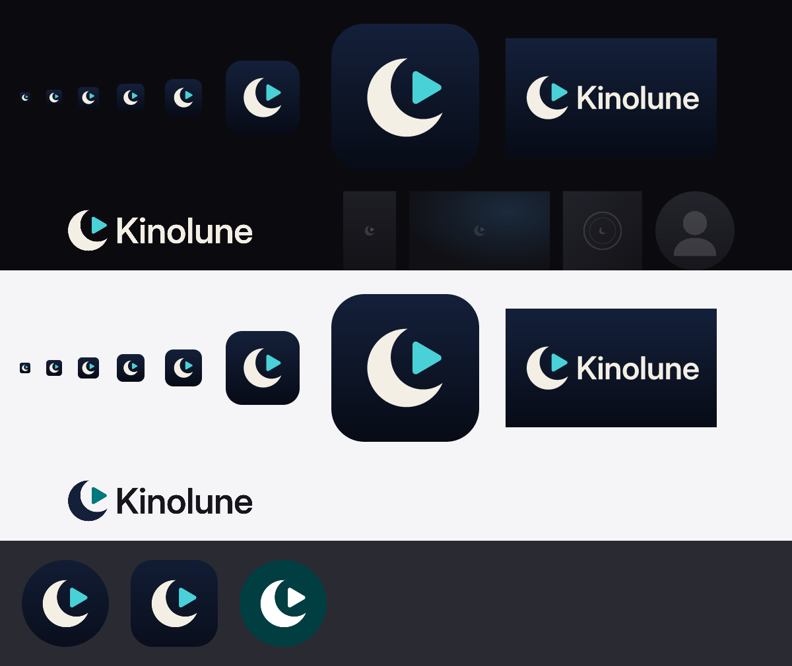

<!-- SPDX-License-Identifier: MPL-2.0 -->

# Бренд Kinolune

Краткий брендбук (DSN-006). Рабочее имя продукта — **Kinolune** (ADR-0011, DEC-004). Пока товарные знаки не проверены вручную, имя в UI задаётся одной константой, а репозиторий и пакеты не переименовываются.



## Идея знака

«Кино» + «lune» (луна): **полумесяц держит кнопку «плей»**. Две простые геометрические фигуры — круг минус круг и скруглённый треугольник. Знак читается от 16 px (вкладка браузера, трей) до экрана телевизора; на 16–32 px используется вариант с крупным знаком и меньшими полями (`app-icon-small.svg`).

## Цвета

| Роль | Цвет | Где |
|---|---|---|
| Ночь, верх градиента | `#14203A` | фон иконки, баннер TV |
| Ночь, низ градиента | `#070B16` | фон иконки, баннер TV |
| Луна | `#F3EFE4` | полумесяц, словесный знак на тёмном |
| Акцент «лунный бирюзовый» | `#49D1D8` = `color.lune.400` | «плей» на тёмном, ссылки и фокус в UI |
| Акцент на светлом | `#00777D` = `color.lune.600` | «плей» на светлом, `accent.default` (белый текст 5,3:1) |
| Чернила | `#16161C` | словесный знак на светлом |

Акцент UI — рампа `color.lune.100…800` в [`../tokens/primitive.tokens.json`](../tokens/primitive.tokens.json) (OKLCH, тон 200). Все пары текста и фона проходят WCAG AA (`just design check`). Сознательно не фиолетово-оранжевый (Infuse) и не цвета других медиаплееров. Красный остаётся только для LIVE.

## Шрифт и словесный знак

Словесный знак — **Inter Display SemiBold** (OFL-1.1), трекинг −1 %, переведён в кривые скриптом [`../scripts/brand-wordmark.mjs`](../scripts/brand-wordmark.mjs) — от установленных шрифтов ничего не зависит. Других шрифтов в бренде нет; в интерфейсе — Inter (см. [`../fonts/`](../fonts/README.md)).

## Правила использования

- Знак и словесный знак не растягивать, не поворачивать, не перекрашивать в произвольные цвета, не добавлять обводки и тени.
- Охранное поле вокруг знака — не меньше ¼ его высоты.
- Минимальный размер: знак — 16 px; локап «знак + Kinolune» — 96 px по ширине.
- На тёмном фоне — `lockup-dark`, на светлом — `lockup-light`. На фото и арте — только на затемнении (`scrim/*`).
- Монохромный вариант (тематические иконки Android 13+, symbolic-иконка Linux) — одна заливка, оба элемента одним цветом.
- Чужие логотипы рядом со знаком (Plex, Jellyfin, Twitch и т. п.) — только по их brand guidelines (DSN-007). Ассеты Infuse/Firecore, Dolby, DTS, Fedora не используем.

## Файлы

```
brand/
├── src/                 # мастер-файлы (правятся руками)
│   ├── mark.svg         # знак, сетка 1024; пути с id "moon" и "play"
│   └── wordmark.svg     # словесный знак в кривых (генерирует brand-wordmark.mjs)
├── export/              # всё ниже генерирует scripts/brand-build.mjs — руками не править
│   ├── svg/             # app-icon, app-icon-small, app-icon-full-bleed, lockup-dark/light, tv-banner
│   ├── android/res/     # mipmap-*/ic_launcher{,_round,_foreground,_background,_monochrome}.png,
│   │                    # mipmap-anydpi-v26/*.xml (adaptive + themed), drawable-xhdpi/tv_banner.png
│   ├── android/play-store-512.png
│   ├── linux/           # icons/hicolor/{16…512, scalable, symbolic}/apps/app.kinolune.*, app.kinolune.desktop
│   ├── windows/app.ico  # 16–256 px
│   ├── web/             # favicon.svg, favicon.ico, icon-192/512.png, apple-touch-icon.png
│   └── logo/            # lockup-dark.png, lockup-light.png
└── preview.png          # сводный лист для ревью
```

Плейсхолдеры для отсутствующего арта — в [`../placeholders/`](../placeholders/README.md).

## Как пересобрать

```bash
just design setup     # один раз: npm ci (resvg-js, opentype.js — версии закреплены)
just design brand     # перегенерировать export/, placeholders/export/ и preview.png
just design check     # CI: токены, контраст, иконки и «экспорт бренда не устарел»
```

Растеризация — [resvg](https://github.com/linebender/resvg) через `@resvg/resvg-js` (MPL-2.0), без платных и системных инструментов; результат побайтно воспроизводим, CI сверяет его с закоммиченными файлами (`npm run brand:check`). Экспорт лежит в обычном git, не в LFS: он маленький (~0,7 МиБ) и нужен сборкам приложения без `git lfs pull`.

Словесный знак меняется редко: возьмите `extras/ttf/InterDisplay-SemiBold.ttf` из закреплённого архива Inter 4.1 (`../fonts/fonts.lock.json`, SHA-256 сверяется) и запустите `just design brand-wordmark <путь к ttf>`, затем `just design brand`.

## Подключение в приложение

- **Android:** скопировать `export/android/res/` в `clients/flutter/app/android/app/src/main/res/`; в манифесте `android:icon="@mipmap/ic_launcher"`, `android:roundIcon="@mipmap/ic_launcher_round"`, для Android TV — `android:banner="@drawable/tv_banner"` у `<application>`.
- **Linux:** `export/linux/icons/` → `$PREFIX/share/icons/`, `app.kinolune.desktop` → `$PREFIX/share/applications/`. Имя иконки `app.kinolune` совпадает с `APPLICATION_ID` и `StartupWMClass`, поэтому окно получает иконку в доке GNOME и KDE.
- **Веб:** `export/web/*` в корень сайта или веб-админки.

## Что ещё не сделано

Слои tvOS (layered image) и Liquid Glass (`.icon` из Icon Composer), ассеты MSIX, AppStream metainfo и иллюстрации пустых состояний — задача DSN-013 (не нужны для релиза 0.1).
