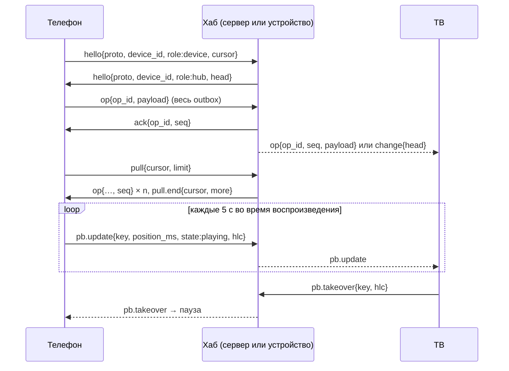

# Протокол синхронизации, версия 1

> Задача `SYNC-002` · реализация: `core/crates/pa-sync/src/proto.rs` · тесты: `core/crates/pa-sync/tests/protocol.rs`.
> Решение: [ADR-0004](../adr/0004-no-project-servers-local-sync.md); исследование: `docs/research/04` §1.8, §1.8.1.

Протокол один для всех транспортов: P2P в LAN (`SYNC-006`), хаб на сервере пользователя (`SYNC-008`), удалённый доступ через iroh. Серверов проекта нет: хабом служит сервер пользователя или любое включённое устройство. Журнал в общей папке SMB/WebDAV (`SYNC-007`) использует тот же формат кадра `op`, но без рукопожатия.

Код протокола не делает ввода-вывода: кодирует, декодирует, проверяет сообщения и согласует версию. Транспорт только передаёт строки и шифрует канал (Noise или TLS с ключами из сопряжения, `SYNC-005`).

## 1. Кадр

- Одно сообщение — один JSON-объект в UTF-8: текстовый кадр WebSocket, сообщение потока QUIC или строка JSONL.
- Поле `t` — тип сообщения. Остальные поля зависят от типа.
- Размер кадра — не больше 256 КиБ (`MAX_FRAME_LEN`), тела `payload` — не больше 64 КиБ.
- Время — Unix-миллисекунды. Позиции и длительности — миллисекунды (`*_ms`).
- `hlc` — метка гибридных логических часов: `{"wall_ms":…, "counter":…, "device":"…"}`. Порядок меток (wall, counter, device) задаёт last-writer-wins.
- Идентификаторы устройств и журналов: `[A-Za-z0-9_-]{1,64}`.

## 2. Версии и совместимость

Есть две независимые версии:

| Версия | Где | Что меняет |
|---|---|---|
| Версия протокола (`PROTOCOL_VERSION`, сейчас 1) | `hello.proto` | набор и смысл сообщений |
| Версия схемы данных (`pa_model::SCHEMA_VERSION`) | внутри `payload` операции | поля операций |

**Согласование.** Сборка версии N объявляет диапазон `{min: N-1, max: N}` (но `min` не меньше 1). Стороны берут наибольшую версию из обоих диапазонов: `v = min(max_A, max_B)`, если `v ≥ max(min_A, min_B)`. Значит, соседние версии (±1) всегда договариваются, а через версию — нет: тогда сторона шлёт `error{code:"proto.unsupported"}` и закрывает соединение.

**Правила расширения внутри версии и для соседней версии:**

- Неизвестные поля игнорируются; новые поля добавляются только необязательными.
- Неизвестный тип сообщения (`t`) игнорируется.
- Неизвестные значения `role` и `state` читаются как `device` и `paused`.
- Операцию с более новой схемой хаб хранит и пересылает, не читая. Устройство, которое её не понимает, не применяет её.
- Удалить поле, сменить его тип или смысл можно только в новой версии протокола.

Точные кадры версии 1 зафиксированы тестом `every_message_matches_its_golden_frame`: если он падает, изменение ломает совместимость.

## 3. Сообщения

| `t` | Кто шлёт | Поля | Зачем |
|---|---|---|---|
| `hello` | обе стороны, первым | `proto{min,max}`, `device_id`, `role` (`device`/`hub`), `cursor?`, `head?`, `nonce?` | рукопожатие; `nonce` — 32 случайных байта (hex) для `auth` |
| `auth` | обе стороны, получив `hello` | `sig` | подпись ключом сопряжённого устройства (§4.1, `SYNC-005`) |
| `family` | член семьи (хаб — после рукопожатия и при каждом изменении) | `body` | обновление семьи: roster и ключ семьи, запечатанный получателю (`pa_pairing::FamilyUpdate`, JSON-текст, ≤ 192 КиБ) |
| `pb.update` | играющее устройство; хаб пересылает | `profile`, `key`, `position_ms`, `duration_ms?`, `rate?` (1 по умолчанию), `state` (`playing`/`paused`/`stopped`), `hlc` | «сейчас играет», мгновенное продолжение |
| `pb.takeover` | устройство, начавшее играть; хаб пересылает | `profile`, `key`, `hlc` | пауза на другом устройстве того же профиля |
| `op` | устройство → хаб; хаб → устройство | `op_id`, `seq?`, `payload{enc, body}` | долговременная операция |
| `ack` | получатель `op` с журналом | `op_id`, `seq?` | операция сохранена, её можно убрать из outbox |
| `change` | хаб | `head{log, seq}` | журнал вырос, можно делать `pull` |
| `pull` | устройство | `cursor?{log, seq}`, `limit` (1…1000) | запросить операции после курсора |
| `pull.end` | хаб | `cursor{log, seq}`, `more` | ответ на `pull` закончен; `more` — есть ещё |
| `error` | любая сторона | `code`, `message?`, `op_id?` | ошибка (коды в §6) |

Пример `op`:

```json
{"t":"op","op_id":"0193…","payload":{"enc":"plain","body":"{\"schema_version\":1,\"data\":{\"op_id\":\"0193…\",\"hlc\":{…},\"op\":\"progress.upsert\",…}}"}}
```

### Непрозрачный payload (готовность к E2E)

Операция передаётся как `payload{enc, body}`:

- `enc: "plain"` — `body` содержит JSON из `outbox::encode`: `{"schema_version":…, "data":{операция}}`. Это та же строка, что лежит в `sync_outbox.payload`.
- Другие значения `enc` зарезервированы под шифрование (например, `secretbox.v1` в `SYNC-010`); тогда `body` — base64 шифротекста.

Хабу нужен только `op_id` вне payload: по нему он дедуплицирует и подтверждает. Поэтому хаб может хранить операции, которые не может прочитать. Получатель проверяет, что `op_id` внутри payload совпадает с внешним.

`pb.update` и `pb.takeover` идут открытым текстом внутри зашифрованного канала. Их не хранят ни в журнале, ни в папке, а хаб — устройство или сервер самого пользователя.

## 4. Сеанс



1. **Рукопожатие.** После установки канала обе стороны сразу шлют `hello`, не дожидаясь друг друга. Версия выбирается по §2. До получения `hello` любое другое сообщение — ошибка `proto.handshake`. Сопряжённые стороны кладут в `hello` свежий `nonce`; получив `hello` собеседника, сторона шлёт `auth{sig}` — подпись Ed25519 своим ключом устройства над обоими `device_id` и обоими `nonce` (`pa_pairing::auth`, домен `kinolune.sync.auth.v1`). Получатель проверяет подпись по своему roster. Если устройство не сопряжено, отозвано, не прислало `auth` первым сообщением после `hello` или подпись неверна — `unauthorized`. `auth` доказывает, кто на другом конце, но не шифрует канал: это задача транспорта (TLS, Noise).
2. **Сначала outbox.** Устройство отправляет все операции из outbox (`outbox::due`). Хаб записывает каждую в журнал и отвечает `ack{op_id, seq}`. Получив `ack`, устройство вызывает `outbox::ack`. Без `ack` операция остаётся в outbox и уходит повторно с экспоненциальной задержкой. Повтор безопасен: хаб дедуплицирует по `op_id` и отвечает тем же `seq`.
3. **Потом pull.** Устройство шлёт `pull` со своим курсором для этого хаба. Хаб отвечает кадрами `op` с `seq` и закрывает ответ `pull.end`. Устройство применяет операции (`Replica::receive`), сохраняет новый курсор и, если `more`, повторяет `pull`.
4. **Дальше — поток.** Новые операции хаб рассылает подключённым устройствам сам (`op` с `seq`) или сообщает `change{head}`. Устройство, у которого курсор отстаёт, делает `pull`.
5. **Ephemeral.** `pb.update` и `pb.takeover` хаб пересылает всем остальным устройствам сразу (цель — не дольше 200 мс). Последний `pb.update` по каждой паре `(profile, key)` хаб держит в памяти несколько минут и отправляет устройству сразу после рукопожатия: только что проснувшееся устройство сразу знает свежую позицию.

`ack` значим только от стороны, которая ведёт журнал (`role: hub`). Обычное устройство может не подтверждать полученные операции.

## 5. Журнал и курсоры

- Журнал хаба — операции в порядке поступления, `seq` с 1, без дубликатов по `op_id`. Эталон — `pa_sync::proto::Journal`; хабы хранят то же в SQLite.
- У журнала есть идентификатор `log` (свежий UUID при создании). Курсор — `{log, seq}`: последний `seq`, который устройство получило из этого журнала.
- Курсор чужого журнала (сменился хаб, журнал пересоздан) означает «с начала». Повторно полученные операции безвредны: состояние сходится по LWW и `op_id`.
- Устройство хранит курсор отдельно для каждого хаба.

## 6. Ошибки

| `code` | Значение | Что делать |
|---|---|---|
| `proto.unsupported` | нет общей версии | закрыть соединение, предложить обновиться |
| `proto.handshake` | сообщение до `hello` | закрыть соединение |
| `bad_message` | кадр не декодируется или не проходит проверку | пропустить кадр |
| `unauthorized` | устройство не сопряжено или отозвано, нет `auth` или подпись неверна | закрыть соединение; отозванному устройству — забыть семью |
| `op.rejected` | операция отклонена навсегда (`op_id` указан) | отправитель может убрать её из outbox |

## 7. Мгновенное продолжение

Требование владельца: перейти на другое устройство и продолжить с той же секунды (допуск ≤ 2 с) без серверов проекта. Правила для `SYNC-003`:

- Позиция при старте — максимум по HLC из локальной записи, последнего `pb.update` и последней операции `progress.upsert`.
- Перед стартом устройство делает `pull` с таймаутом 500–800 мс. Если более новая позиция пришла позже, плеер предлагает «Перейти к 41:11?», а не прыгает молча.
- `pb.update` не попадает в outbox и журнал; в долговременный прогресс превращается только операция `progress.upsert` на паузе, остановке, каждые 30 с и при выходе.
- Начав играть, устройство шлёт `pb.takeover`; другие устройства того же профиля ставят паузу (настраивается). Разные профили не конфликтуют.

## 8. Хаб на сервере пользователя (режим B)

> Задача `SYNC-008` · реализация: `server/src/sync/` · тесты: `server/tests/sync_hub.rs`.

- **Адрес:** WebSocket `ws://<сервер>:<порт>/api/v1/sync` (порт по умолчанию 8096). Сервер находится в LAN по DNS-SD `_projectalpha._tcp` (анонс — `SRV-004`), вне дома — через iroh или VPN пользователя. Кадры — текстовые, не больше `MAX_FRAME_LEN`; бинарный кадр получает `bad_message`.
- **Рукопожатие:** сервер шлёт `hello{role:"hub", device_id, head}` сразу после upgrade. `device_id` хаба постоянный и хранится вместе с журналом. На `hello` ждёт 10 с.
- **Журнал:** SQLite `sync.sqlite3` в каталоге данных сервера (отдельно от `library.sqlite3`: схема медиатеки общая с клиентами). Семантика — как у `pa_sync::proto::Journal`, проверяется тестом на совпадение ответов. Компактизации пока нет.
- **Операции:** на каждый `op` — `ack{op_id, seq}` после записи в журнал; новая операция сразу рассылается остальным устройствам как `op` с `seq`. Повтор того же `op_id` (повтор из outbox или та же операция, пришедшая и по P2P) получает тот же `seq` и не рассылается повторно. Если запись в журнал не удалась, `ack` не приходит и устройство повторит отправку.
- **Сервер авторитетен для своей медиатеки:** операции `progress.upsert`, `watched`, `unwatch` с `enc:"plain"` сервер ещё и записывает в `progress` своей `library.sqlite3` (`pa_library::progress::apply_remote`, LWW по времени операции; неизвестный профиль пропускается). Зашифрованные операции и операции новой схемы только хранятся и пересылаются.
- **После рукопожатия** сервер шлёт последние `pb.update` по каждой паре `(profile, key)` моложе `sync.playback_ttl_secs` (по умолчанию 600 с; только в памяти, на диск не пишутся), затем `change{head}`, если курсор устройства из `hello` отстаёт или относится к другому журналу.
- **Fan-out:** `pb.update` и `pb.takeover` пересылаются остальным устройствам исходным кадром (неизвестные поля новых версий сохраняются). Устройство, которое не успевает читать (очередь 4096 кадров), получает `change{head}` и догоняет операции через `pull`; пропущенные `pb.update` не восстанавливаются — придёт следующий.
- **Жизнь соединения:** ping каждые 30 с; соединение без входящих кадров 90 с закрывается. Не больше `sync.max_connections` устройств (256), лишние получают HTTP 503. При остановке сервер закрывает соединения и делает checkpoint журнала.
- **Аутентификация (`SYNC-005`):** `hello` хаба несёт `nonce`; устройство обязано ответить `auth` (§4.1), хаб тоже шлёт свой `auth`. Неизвестное, отозванное устройство и устройство без `nonce` получают `error{unauthorized}`, соединение закрывается. Устройство, отозванное во время работы, отключается сразу. После рукопожатия хаб шлёт `family` с roster и ключом семьи для этого устройства и повторяет его при каждом изменении (новое устройство, отзыв, ротация ключа). `family` от сопряжённого устройства хаб сливает в свой roster: отзыв, сделанный на телефоне, доходит до сервера и отключает отозванного. `sync.require_pairing = false` пускает и несопряжённые устройства (тесты, доверенный loopback). Сервер по умолчанию по-прежнему слушает только `127.0.0.1`; шифрования канала до `SRV-004` нет.

## 9. Сопряжение (семья устройств)

> Задача `SYNC-005` · решение: [ADR-NNNN](../adr/0026-device-family-pairing.md) · реализация: `core/crates/pa-pairing`, `server/src/pairing.rs` · тесты: `core/crates/pa-pairing`, `server/tests/pairing.rs`.

- **Ключи.** У каждого устройства — Ed25519 (подписи) и X25519 (доставка ключа семьи) в `SecretStore`. Roster (trust store) — подписанные записи устройств и отзывов; его проверяет и сливает любое устройство, общий центр не нужен. Ключ семьи (эпоха + 256 бит) ротируется при отзыве.
- **Канал.** Отдельные кадры JSON с полем `t` (`pair.hello`, `pair.intro`, `pair.welcome`, `pair.error`), по одному на текстовый кадр WebSocket. У сервера — `ws://<сервер>:<порт>/api/v1/pair`; сервер — приглашающий.
- **Обмен.** Обе стороны шлют `pair.hello{v:1, spake}` (SPAKE2, код — пароль). Присоединяющийся шлёт `pair.intro{sealed}` (устройство, имя, вид, открытые ключи, подпись транскрипта), приглашающий отвечает `pair.welcome{sealed}` (roster с новой записью, ключ семьи, подпись транскрипта). Неверный код виден по `pair.intro`, который не расшифровывается: ответ `pair.error{code:"pair.code"}`. Нет открытого приглашения или попытки кончились — `pair.error{code:"pair.expired"}`.
- **Код.** 6 цифр (вводит человек) или 128 бит в QR: `projectalpha://pair?v=1&c=<код>&k=<ключ подписи приглашающего, hex>&a=<host:port>`. По QR присоединяющийся сверяет ключ приглашающего. Приглашение действует 5 минут, 5 попыток, после успеха гасится.
- **Администрирование сервера** (только с loopback до `SRV-003`): `POST /api/v1/pair/invite[?kind=qr]` → `{code, qr, expires_ms, fingerprint}`; `GET /api/v1/devices` → `{family, devices:[{device_id, name, kind, fingerprint, added_ms, revoked_ms?}]}`; `DELETE /api/v1/devices/{id}` — отзыв и ротация ключа (204; 404 — неизвестен; 410 — уже отозван).
- **Производительность** (тест `load_50_devices_10_messages_per_second`): 50 устройств по 10 сообщений в секунду (9 `pb.update` и 1 `op`), каждое доходит до 49 остальных; p95 задержки — около 35 мс в debug-сборке при пороге 200 мс.
