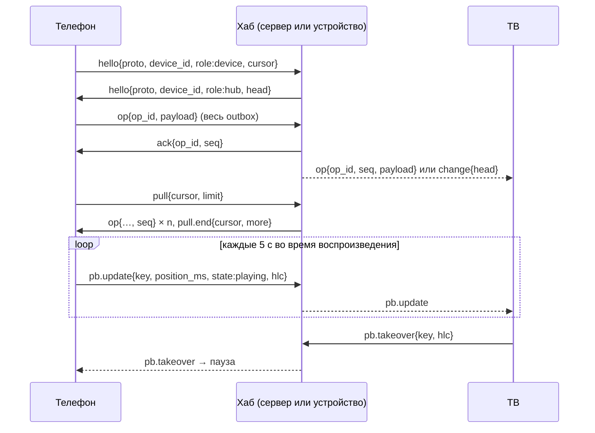

# Протокол синхронизации, версия 1

> Задача `SYNC-002` · реализация: `core/crates/pa-sync/src/proto.rs` · тесты: `core/crates/pa-sync/tests/protocol.rs`.
> Решение: [ADR-0004](../adr/0004-no-project-servers-local-sync.md); исследование: `docs/research/04` §1.8, §1.8.1.

Протокол один для всех транспортов: P2P в LAN (`SYNC-006`), хаб на сервере пользователя (`SYNC-008`), удалённый доступ через iroh. Серверов проекта нет: хабом служит сервер пользователя или любое включённое устройство. Журнал в общей папке SMB/WebDAV (`SYNC-007`) использует тот же формат кадра `op`, но без рукопожатия.

Код протокола не делает ввода-вывода: кодирует, декодирует, проверяет сообщения и согласует версию. Транспорт только передаёт строки и шифрует канал (Noise или TLS с ключами из сопряжения, `SYNC-005`).

## 1. Кадр

- Одно сообщение — один JSON-объект в UTF-8: текстовый кадр WebSocket, сообщение потока QUIC или строка JSONL.
- Поле `t` — тип сообщения. Остальные поля зависят от типа.
- Размер кадра — не больше 256 КиБ (`MAX_FRAME_LEN`), тела `payload` — не больше 64 КиБ.
- Время — Unix-миллисекунды. Позиции и длительности — миллисекунды (`*_ms`).
- `hlc` — метка гибридных логических часов: `{"wall_ms":…, "counter":…, "device":"…"}`. Порядок меток (wall, counter, device) задаёт last-writer-wins.
- Идентификаторы устройств и журналов: `[A-Za-z0-9_-]{1,64}`.

## 2. Версии и совместимость

Есть две независимые версии:

| Версия | Где | Что меняет |
|---|---|---|
| Версия протокола (`PROTOCOL_VERSION`, сейчас 1) | `hello.proto` | набор и смысл сообщений |
| Версия схемы данных (`pa_model::SCHEMA_VERSION`) | внутри `payload` операции | поля операций |

**Согласование.** Сборка версии N объявляет диапазон `{min: N-1, max: N}` (но `min` не меньше 1). Стороны берут наибольшую версию из обоих диапазонов: `v = min(max_A, max_B)`, если `v ≥ max(min_A, min_B)`. Значит, соседние версии (±1) всегда договариваются, а через версию — нет: тогда сторона шлёт `error{code:"proto.unsupported"}` и закрывает соединение.

**Правила расширения внутри версии и для соседней версии:**

- Неизвестные поля игнорируются; новые поля добавляются только необязательными.
- Неизвестный тип сообщения (`t`) игнорируется.
- Неизвестные значения `role` и `state` читаются как `device` и `paused`.
- Операцию с более новой схемой хаб хранит и пересылает, не читая. Устройство, которое её не понимает, не применяет её.
- Удалить поле, сменить его тип или смысл можно только в новой версии протокола.

Точные кадры версии 1 зафиксированы тестом `every_message_matches_its_golden_frame`: если он падает, изменение ломает совместимость.

## 3. Сообщения

| `t` | Кто шлёт | Поля | Зачем |
|---|---|---|---|
| `hello` | обе стороны, первым | `proto{min,max}`, `device_id`, `role` (`device`/`hub`), `cursor?`, `head?` | рукопожатие |
| `pb.update` | играющее устройство; хаб пересылает | `profile`, `key`, `position_ms`, `duration_ms?`, `rate?` (1 по умолчанию), `state` (`playing`/`paused`/`stopped`), `hlc` | «сейчас играет», мгновенное продолжение |
| `pb.takeover` | устройство, начавшее играть; хаб пересылает | `profile`, `key`, `hlc` | пауза на другом устройстве того же профиля |
| `op` | устройство → хаб; хаб → устройство | `op_id`, `seq?`, `payload{enc, body}` | долговременная операция |
| `ack` | получатель `op` с журналом | `op_id`, `seq?` | операция сохранена, её можно убрать из outbox |
| `change` | хаб | `head{log, seq}` | журнал вырос, можно делать `pull` |
| `pull` | устройство | `cursor?{log, seq}`, `limit` (1…1000) | запросить операции после курсора |
| `pull.end` | хаб | `cursor{log, seq}`, `more` | ответ на `pull` закончен; `more` — есть ещё |
| `error` | любая сторона | `code`, `message?`, `op_id?` | ошибка (коды в §6) |

Пример `op`:

```json
{"t":"op","op_id":"0193…","payload":{"enc":"plain","body":"{\"schema_version\":1,\"data\":{\"op_id\":\"0193…\",\"hlc\":{…},\"op\":\"progress.upsert\",…}}"}}
```

### Непрозрачный payload (готовность к E2E)

Операция передаётся как `payload{enc, body}`:

- `enc: "plain"` — `body` содержит JSON из `outbox::encode`: `{"schema_version":…, "data":{операция}}`. Это та же строка, что лежит в `sync_outbox.payload`.
- Другие значения `enc` зарезервированы под шифрование (например, `secretbox.v1` в `SYNC-010`); тогда `body` — base64 шифротекста.

Хабу нужен только `op_id` вне payload: по нему он дедуплицирует и подтверждает. Поэтому хаб может хранить операции, которые не может прочитать. Получатель проверяет, что `op_id` внутри payload совпадает с внешним.

`pb.update` и `pb.takeover` идут открытым текстом внутри зашифрованного канала. Их не хранят ни в журнале, ни в папке, а хаб — устройство или сервер самого пользователя.

## 4. Сеанс



1. **Рукопожатие.** После установки канала обе стороны сразу шлют `hello`, не дожидаясь друг друга. Версия выбирается по §2. До получения `hello` любое другое сообщение — ошибка `proto.handshake`. Если устройство не сопряжено или отозвано — `unauthorized`.
2. **Сначала outbox.** Устройство отправляет все операции из outbox (`outbox::due`). Хаб записывает каждую в журнал и отвечает `ack{op_id, seq}`. Получив `ack`, устройство вызывает `outbox::ack`. Без `ack` операция остаётся в outbox и уходит повторно с экспоненциальной задержкой. Повтор безопасен: хаб дедуплицирует по `op_id` и отвечает тем же `seq`.
3. **Потом pull.** Устройство шлёт `pull` со своим курсором для этого хаба. Хаб отвечает кадрами `op` с `seq` и закрывает ответ `pull.end`. Устройство применяет операции (`Replica::receive`), сохраняет новый курсор и, если `more`, повторяет `pull`.
4. **Дальше — поток.** Новые операции хаб рассылает подключённым устройствам сам (`op` с `seq`) или сообщает `change{head}`. Устройство, у которого курсор отстаёт, делает `pull`.
5. **Ephemeral.** `pb.update` и `pb.takeover` хаб пересылает всем остальным устройствам сразу (цель — не дольше 200 мс). Последний `pb.update` по каждой паре `(profile, key)` хаб держит в памяти несколько минут и отправляет устройству сразу после рукопожатия: только что проснувшееся устройство сразу знает свежую позицию.

`ack` значим только от стороны, которая ведёт журнал (`role: hub`). Обычное устройство может не подтверждать полученные операции.

## 5. Журнал и курсоры

- Журнал хаба — операции в порядке поступления, `seq` с 1, без дубликатов по `op_id`. Эталон — `pa_sync::proto::Journal`; хабы хранят то же в SQLite.
- У журнала есть идентификатор `log` (свежий UUID при создании). Курсор — `{log, seq}`: последний `seq`, который устройство получило из этого журнала.
- Курсор чужого журнала (сменился хаб, журнал пересоздан) означает «с начала». Повторно полученные операции безвредны: состояние сходится по LWW и `op_id`.
- Устройство хранит курсор отдельно для каждого хаба.

## 6. Ошибки

| `code` | Значение | Что делать |
|---|---|---|
| `proto.unsupported` | нет общей версии | закрыть соединение, предложить обновиться |
| `proto.handshake` | сообщение до `hello` | закрыть соединение |
| `bad_message` | кадр не декодируется или не проходит проверку | пропустить кадр |
| `unauthorized` | устройство не сопряжено или отозвано | закрыть соединение |
| `op.rejected` | операция отклонена навсегда (`op_id` указан) | отправитель может убрать её из outbox |

## 7. Мгновенное продолжение

Требование владельца: перейти на другое устройство и продолжить с той же секунды (допуск ≤ 2 с) без серверов проекта. Правила для `SYNC-003`:

- Позиция при старте — максимум по HLC из локальной записи, последнего `pb.update` и последней операции `progress.upsert`.
- Перед стартом устройство делает `pull` с таймаутом 500–800 мс. Если более новая позиция пришла позже, плеер предлагает «Перейти к 41:11?», а не прыгает молча.
- `pb.update` не попадает в outbox и журнал; в долговременный прогресс превращается только операция `progress.upsert` на паузе, остановке, каждые 30 с и при выходе.
- Начав играть, устройство шлёт `pb.takeover`; другие устройства того же профиля ставят паузу (настраивается). Разные профили не конфликтуют.
