# Обзор архитектуры project_alpha

> Задача `DOC-003` · актуально для вехи **M1** (плеер-MVP, режим A) · обновлено 2026-11-13.
> Это карта, а не спецификация: решения и их обоснование — в [ADR](../adr/README.md), детали — в [исследованиях](../research/) и задачах [ROADMAP](../ROADMAP.md). Если документ расходится с ADR или [STRATEGY](../STRATEGY.md) v2, правы они, а этот файл нужно поправить.
> Граф реальных крейтов генерируется: [crate-graph.md](crate-graph.md).

**Условные обозначения.** На схемах сплошная линия — уже решено и входит в план вехи; пунктир — опционально или позже. Компоненты, которых в коде ещё нет, описаны как целевое состояние; что уже есть в репо — в §11.

## Содержание

1. [Принципы](#1-принципы)
2. [Контекст: что где работает](#2-контекст-что-где-работает)
3. [Компоненты](#3-компоненты)
4. [Ядро: целевой состав крейтов](#4-ядро-целевой-состав-крейтов)
5. [Режимы A, B и C](#5-режимы-a-b-и-c)
6. [Поток данных: скан → распознавание → медиатека → воспроизведение](#6-поток-данных-скан--распознавание--медиатека--воспроизведение)
7. [Воспроизведение](#7-воспроизведение)
8. [Синхронизация](#8-синхронизация)
9. [Медиасервер и очередь задач](#9-медиасервер-и-очередь-задач)
10. [NAS-дистрибутив и обновления](#10-nas-дистрибутив-и-обновления)
11. [Сборки, флейворы и удалённый конфиг](#11-сборки-флейворы-и-удалённый-конфиг)
12. [Twitch: открытый вопрос](#12-twitch-открытый-вопрос)
13. [Открытые вопросы](#13-открытые-вопросы)
14. [Как поддерживать документ](#14-как-поддерживать-документ)

---

## 1. Принципы

| Принцип | Что значит для архитектуры | Источник |
|---|---|---|
| Никаких серверов проекта | Данные пользователя не проходят через наши домены. Устройства и сервер пользователя ходят напрямую в TMDB, AniList, Twitch и т. п. От проекта — только статические файлы: GitHub Releases, GitHub Pages, GHCR, R2 для ISO | [ADR-0004](../adr/0004-no-project-servers-local-sync.md), [STRATEGY §1–2](../STRATEGY.md) |
| Одно ядро на Rust | Вся бизнес-логика (источники, медиатека, распознавание, синхронизация, клиенты сервисов) — в `core/crates/pa-*`. UI не дублирует логику ядра | [ADR-0001](../adr/0001-rust-core-uniffi-frb.md) |
| Режим A и режим B — один код | Клиент в режиме A — «встроенный сервер без HTTP»: тот же сканер, схема БД и конвейер метаданных. Сервер — то же ядро плюс HTTP, watcher, транскод и многопользовательность | [04 §1.1](../research/04-backend-architecture-billing.md) |
| UI отдельно от видео | Flutter (и SwiftUI на tvOS) рисует экраны и оверлей; видео всегда идёт в нативную поверхность | [ADR-0002](../adr/0002-flutter-ui-swiftui-tvos.md), [ADR-0003](../adr/0003-native-player-surfaces-engines.md) |
| Только LGPL для FFmpeg и mpv | Динамическая линковка, `--disable-gpl`, mpv `-Dgpl=false`; GPL-кода в клиентах нет | [ADR-0005](../adr/0005-license-mpl2-dco.md) |
| Два флейвора сборки | `store` физически не содержит архива Twitch и донат-ссылок; `full` — всё | [ADR-0007](../adr/0007-store-full-build-flavors.md) |
| Равноправные режимы | A (только приложение), B (свой сервер), C (Plex/Jellyfin/Emby) — одинаково полноценны, включая синхронизацию | [STRATEGY §1](../STRATEGY.md), [ADR-0004](../adr/0004-no-project-servers-local-sync.md) |

---

## 2. Контекст: что где работает

Все прямоугольники с данными пользователя — на его устройствах. У проекта нет узла, через который идут запросы.

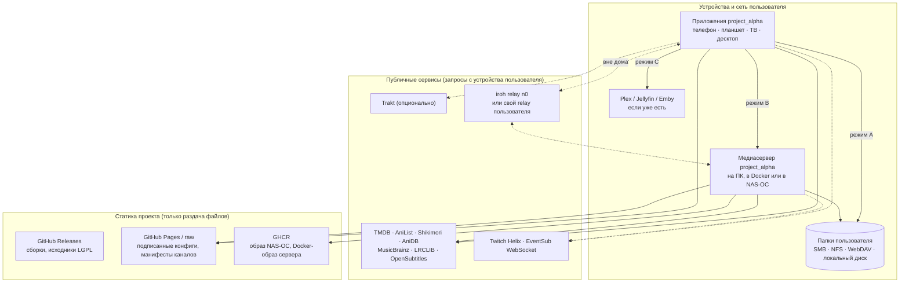

Что из исследований **не** входит в архитектуру (отменено STRATEGY v2): облако `cloud-api`, Postgres, entitlement-токены, биллинг ([04 §2–3](../research/04-backend-architecture-billing.md)), metadata-шлюз и краудсорс-база хэшей ([03 §4.8](../research/03-metadata-recognition.md)), облачный Twitch-шлюз и EventSub-webhook ([06 §1.2–1.4](../research/06-twitch-integration.md)), relay на VPS проекта ([04 §1.7](../research/04-backend-architecture-billing.md)). Если вы видите их на схемах исследований — игнорируйте.

---

## 3. Компоненты

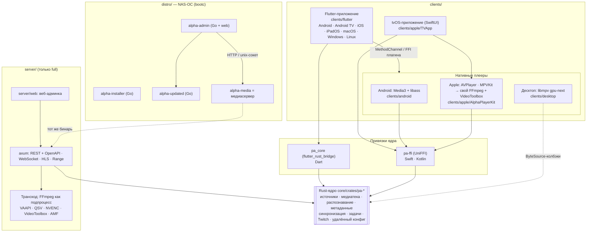

| Компонент | Язык | Каталог | Решение |
|---|---|---|---|
| Ядро | Rust (tokio, SQLite WAL + FTS5) | `core/crates/` | [ADR-0001](../adr/0001-rust-core-uniffi-frb.md) |
| Привязки | UniFFI (Swift/Kotlin), flutter_rust_bridge (Dart) | `core/crates/pa-ffi`, `clients/flutter/packages/pa_core` | [ADR-0001](../adr/0001-rust-core-uniffi-frb.md) |
| UI | Flutter; SwiftUI для tvOS | `clients/flutter`, `clients/apple/TVApp` | [ADR-0002](../adr/0002-flutter-ui-swiftui-tvos.md) |
| Плееры | Kotlin, Swift, C/C++ | `clients/{android,apple,desktop}`, `clients/flutter/packages/pa_player_*` | [ADR-0003](../adr/0003-native-player-surfaces-engines.md), [0008](../adr/0008-android-player-embedding.md), [0009](../adr/0009-desktop-player-embedding.md) |
| Медиасервер | Rust (axum) поверх ядра | `server/` | [04 §1.5](../research/04-backend-architecture-billing.md) |
| NAS-ОС | bootc-образ; установщик и демоны на Go | `distro/` | [ADR-0010](../adr/0010-nas-os-phase0.md), [05](../research/05-nas-linux-distro.md) |
| Дизайн-токены | W3C DTCG → Style Dictionary | `design/` | [design/decisions](../../design/decisions/0001-design-tool.md) |
| Удалённые конфиги | подписанный (minisign) JSON | `config/` | [ADR-0004](../adr/0004-no-project-servers-local-sync.md), [ADR-0006](../adr/0006-public-monorepo-layout-ownership.md) |

Раскладка монорепо и владение каталогами — [ADR-0006](../adr/0006-public-monorepo-layout-ownership.md) и [ROADMAP §0.4](../ROADMAP.md#04-целевая-структура-монорепо-и-владение-каталогами).

---

## 4. Ядро: целевой состав крейтов

Целевая схема по [ROADMAP §0.4](../ROADMAP.md#04-целевая-структура-монорепо-и-владение-каталогами) (уточнение [04 §1.3](../research/04-backend-architecture-billing.md): `pa-parse` вошёл в `pa-recognition`, `pa-entitlement` отменён). Это **план**, а не факт: какие крейты реально существуют и как связаны — смотрите в сгенерированном [crate-graph.md](crate-graph.md). Стрелка — «зависит от»; фундаментальные зависимости (`pa-model`, `pa-log`, `pa-runtime`) у большинства крейтов не нарисованы.

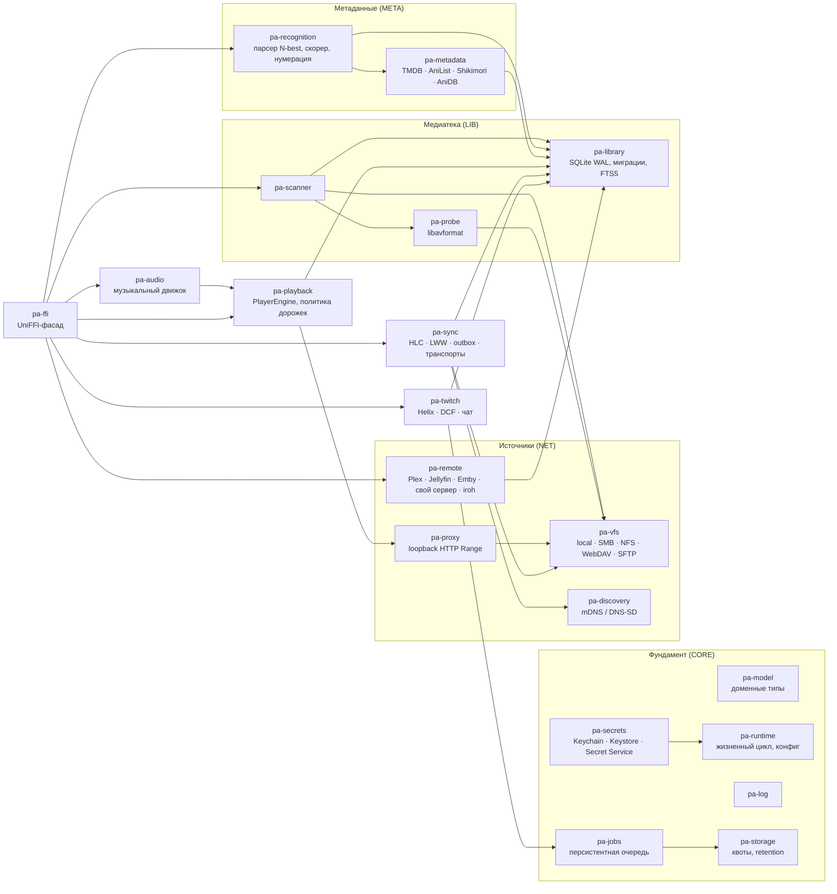

Правила: каждый домен экспортируется в FFI своим модулем `pa-ffi/src/<domain>.rs` (горячие файлы — [ROADMAP §0.5](../ROADMAP.md#05-горячие-файлы-и-правила-их-правки)); воспроизведение видео в ядро не входит — ядро отдаёт байты и политику, а не кадры.

---

## 5. Режимы A, B и C

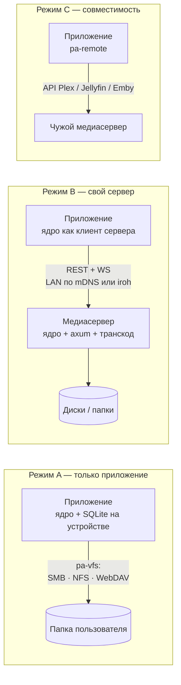

| | A | B | C |
|---|---|---|---|
| Где медиатека (SQLite) | на каждом устройстве | на сервере; клиент кэширует | у Plex/Jellyfin/Emby; клиент кэширует |
| Кто сканирует и распознаёт | приложение | сервер (с watcher и ed2k) | чужой сервер |
| Как отдаются байты | `pa-vfs` → `pa-proxy`/ByteSource | direct play по Range → remux → HLS-транскод | их direct play / транскод |
| Синхронизация прогресса | P2P в LAN или журнал в папке | сервер — хаб | их «просмотрено» ↔ наш протокол |
| Веха | **M1** | M4 | M4 |

Режим A — основной для M1. На tvOS большая медиатека в режиме A ограничена хранилищем Apple TV ([04 §1.4](../research/04-backend-architecture-billing.md)); для больших библиотек рекомендуем режим B.

---

## 6. Поток данных: скан → распознавание → медиатека → воспроизведение

Основной сценарий M1 (режим A). Задачи: `NET-001…004`, `NET-007/008`, `LIB-001…009`, `META-013`, `PLAY-003…005`. Полный конвейер распознавания из 8 этапов — [03 §4.2](../research/03-metadata-recognition.md); в M1 работает базовый матчер «название + год → TMDB» (`META-013`), N-best и скорер приходят в M2.

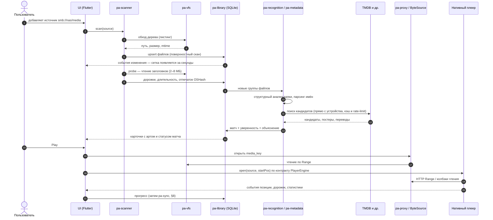

Ключевые детали:
- **Повторный скан инкрементальный** по `(path, size, mtime)`; на сетевых папках событий нет — пересканирование по таймеру, при открытии или вручную ([04 §1.4](../research/04-backend-architecture-billing.md)).
- **Единица распознавания — группа файлов**, а не файл; каждый матч хранит уверенность и «почему» ([03 §4.1](../research/03-metadata-recognition.md)). Ручное исправление становится правилом папки `FolderRule` (M2).
- **ed2k-хэш** (полное чтение файла) в режиме A по умолчанию не считается — только на сервере ([03 §4.2](../research/03-metadata-recognition.md)).
- **Метаданные запрашиваются напрямую** с устройства: ключ проекта по умолчанию плюс поле «свой ключ» (DEC-008, [ADR-0004](../adr/0004-no-project-servers-local-sync.md)). Условия провайдеров и TTL кэша — [docs/legal/providers.md](../legal/providers.md).
- **Маппинги аниме** — встроенный снапшот в `data/anime-mappings/`, обновляется с GitHub ([docs/legal/anime-mappings.md](../legal/anime-mappings.md)).
- **Ключ медиа для синхронизации** — внешний ID (TMDB/TVDB/IMDb + сезон/серия) или `content_fingerprint`, а не путь: одна и та же серия по разным путям на разных устройствах — один ключ.

---

## 7. Воспроизведение

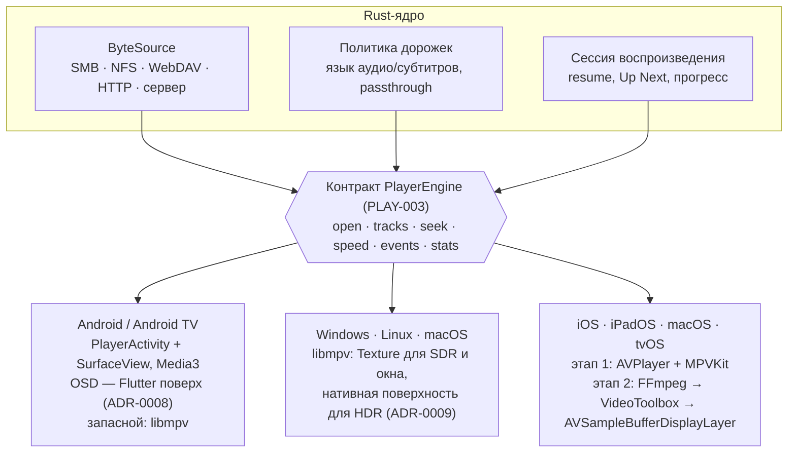

- Выбор движка «Auto»: основной движок, если он может сыграть файл с учётом HDR/DV; иначе запасной; пользователь может выбрать вручную ([ADR-0003](../adr/0003-native-player-surfaces-engines.md), [02 §2.8](../research/02-client-stack-playback.md)).
- HDR/DV и AFR через Flutter `Texture` невозможны — поэтому поверхность всегда нативная, а Flutter рисует только OSD.
- Статус встраивания: ADR-0008 и ADR-0009 — **предложены**, ждут замеров на реальном Android TV и на Windows/macOS. Спайки — `spikes/android-player/`, `spikes/desktop-player/`.

---

## 8. Синхронизация

Один протокол (`SYNC-002`, будущий `docs/api/sync-protocol.md`), три транспорта и опциональный Trakt. Модель — LWW по HLC и `device_id`, «просмотрено» монотонно, ключ записи `(profile, media_key)`; Twitch VOD — `twitch:vod:<id>` для онлайн-просмотра и скачанного файла. Решение — [ADR-0004](../adr/0004-no-project-servers-local-sync.md), протокол — [04 §1.8.1](../research/04-backend-architecture-billing.md) (без облачной части).

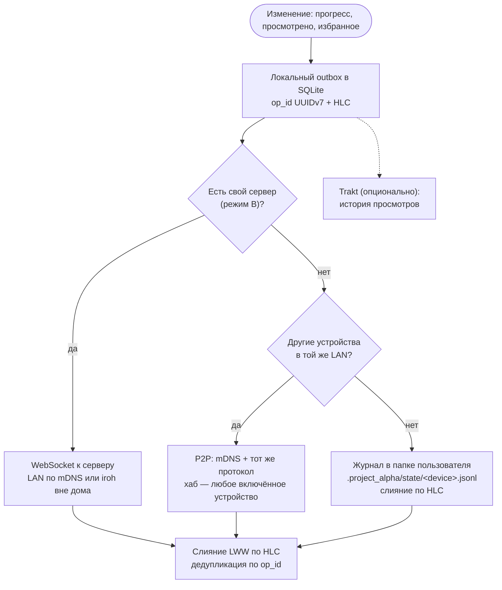

Мгновенное продолжение на другом устройстве (цель M3 — точность ≤ 2 с):

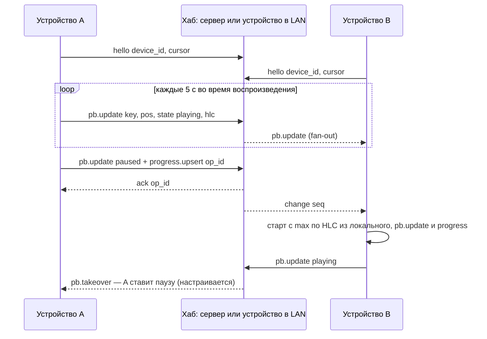

Без хаба (только журнал в папке) синхронизация не мгновенная: устройства сходятся при следующем чтении журнала. Push-уведомлений от имени проекта нет (APNs/FCM требуют сервер) — только локальные уведомления и опрос.

---

## 9. Медиасервер и очередь задач

Сервер — один Rust-бинарь поверх того же ядра (`SRV-*`, веха M4). SQLite WAL, REST + OpenAPI 3.1, WebSocket-события, mDNS-анонс `_projectalpha._tcp`, удалённый доступ через iroh. Компоненты — [04 §1.5–1.7](../research/04-backend-architecture-billing.md); облачный pairing и registry оттуда отменены: клиенты сопрягаются с сервером локально (QR/код, `SRV-003`, `SYNC-005`).

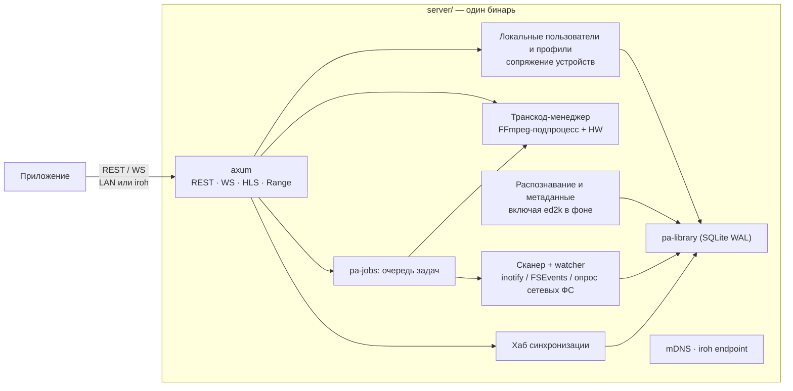

**Выбор способа отдачи** по профилю клиента: direct play (файл по HTTP Range, основной случай) → remux (`-c copy` в HLS fMP4, например MKV для AVPlayer) → транскод (только нужная дорожка, HW-ускорение, HDR→SDR тон-маппинг). FFmpeg — внешний процесс: изоляция крашей и лицензий.

**Очередь задач `pa-jobs`** — общая для сервера и клиентов (`CORE-011`, `SRV-011`). Типы: `library_scan`, `metadata_refresh`, `transcode_optimize`, `offline_copy`, `cleanup`; в full-сборках — Twitch-задачи (§12). Персистентна, переживает перезапуск, докачивает по Range/сегментам. Лимиты параллельности по типу; квоты, резерв места и retention — `pa-storage` (`CORE-012`, `SRV-015`).

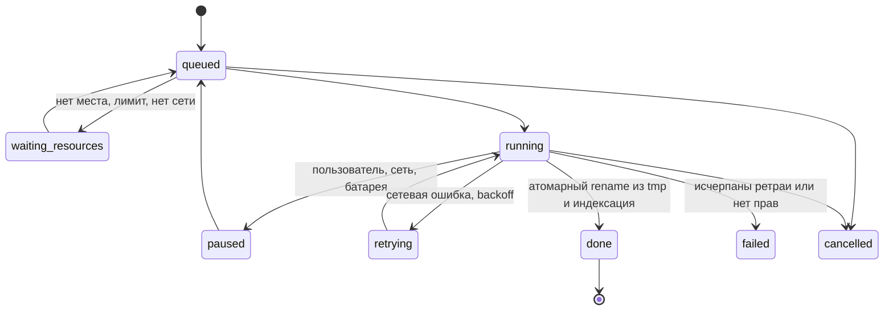

Прогресс задач идёт событиями WS (`job.progress`, `job.done`) всем клиентам владельца. Облачного «почтового ящика» для команд к выключенному серверу нет — если сервер недоступен, клиент ставит задачу в свой outbox и отправляет при подключении.

---

## 10. NAS-дистрибутив и обновления

NAS-ОС — образ на `fedora-bootc` (название без «Fedora»), установщик и системные демоны на Go, медиасервер нативно в образе (`/usr/lib/alpha-media`, состояние в `/var/lib/alpha-media`). Решение — [ADR-0010](../adr/0010-nas-os-phase0.md), подробности — [05 §4](../research/05-nas-linux-distro.md), прототип — [`distro/`](../../distro/README.md).

Сборка и публикация — только GitHub Actions и статика: образ в GHCR с подписью cosign, манифест канала `channels/<ch>.json` с подписью minisign — на GitHub Pages (`DIST-012`, `SITE-004`). Своего «release service» нет.

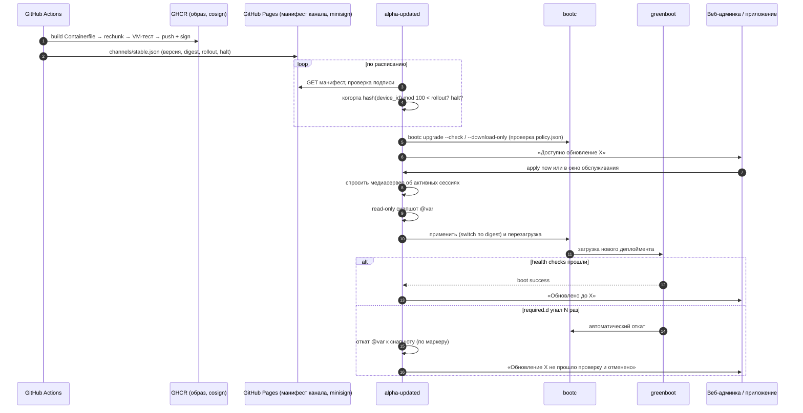

Правила, которые влияют на другие полосы: миграции БД медиасервера обратно совместимы на одну версию (expand → contract, `LIB-002`), потому что bootc не откатывает `/var`; отказ диска с данными не должен вызывать откат ОС (только `wanted.d`). Штатный `bootc-fetch-apply-updates.timer` замаскирован — обновлениями управляет `alpha-updated`.

---

## 11. Сборки, флейворы и удалённый конфиг

| Флейвор | Каналы | Отличия |
|---|---|---|
| `full` | GitHub Releases, F-Droid, Flathub, AUR, winget, ISO, Docker | всё включено; сервер и NAS-ОС существуют только здесь |
| `store` | App Store, Google Play, Microsoft Store | без загрузок и записи Twitch, без внешних донат-ссылок; код этих функций не компилируется |

Реализация — cargo features `store`/`full` (`twitch-archive`, `donation-links`), `--dart-define` во Flutter, Gradle flavors, Xcode schemes ([ADR-0007](../adr/0007-store-full-build-flavors.md)). Флейвор не меняет форматы данных и протоколы: store- и full-клиенты синхронизируются друг с другом.

**Удалённый конфиг и kill-switch без сервера** (`CORE-014`): JSON-файлы в `config/` этого репо, подписанные minisign, раздаются через GitHub Pages/raw. Клиент проверяет подпись, кэширует и при недоступности работает с последним валидным конфигом.

**Что уже есть в репозитории** (на момент обновления): каркас монорепо и workspace (`REPO-001`), ADR 0001–0010, LGPL-сборка FFmpeg для части таргетов (`tools/ffmpeg`, `PLAY-001`), спайки плееров Android и десктопа, прототип bootc-образа (`distro/`), формат корпуса распознавания (`tools/recognition-eval`), дизайн-токены (`design/`). Крейтов ядра ещё нет — см. [crate-graph.md](crate-graph.md).

---

## 12. Twitch: открытый вопрос

> **Статус: дизайн воспроизведения и загрузки Twitch не утверждён — на юридической проверке** (`LEGAL-006`, owner).
> [docs/legal/providers.md §2.4](../legal/providers.md) фиксирует блокер: Twitch Developer Services Agreement требует использовать **официальный встраиваемый плеер** для всего видео Twitch (другой плеер — только с письменного разрешения), запрещает хранить копии контента дольше 24 ч и не допускает недокументированных эндпоинтов. Это противоречит нативному плееру через GQL → usher и загрузкам, которые предлагает [06 §2.1, §2.7](../research/06-twitch-integration.md).

Что считается **устойчивым** (не зависит от исхода проверки):
- Helix-клиент в `pa-twitch` прямо с устройства или сервера пользователя, вход через Device Code Flow с публичным `client_id` без секрета (`TWI-001`, `TWI-002`); кэш данных Helix — не дольше 24 ч.
- Уведомления «в эфире» — EventSub WebSocket или опрос с устройства/сервера; облачного webhook нет ([ADR-0004](../adr/0004-no-project-servers-local-sync.md)).
- Ключ синхронизации `twitch:vod:<id>` и модель данных Twitch в медиатеке (`TWI-007`).
- Никакой блокировки рекламы.

Что **под вопросом** и может поменяться:

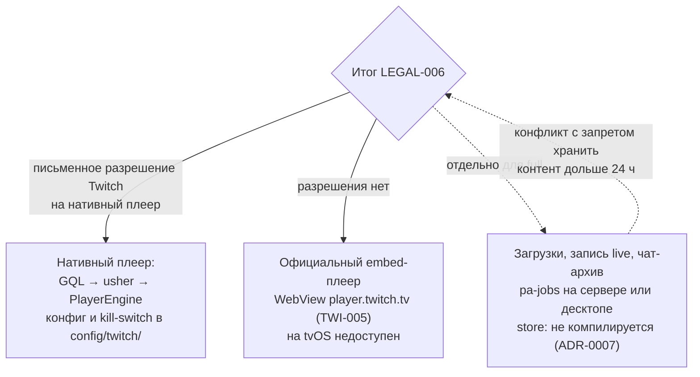

До решения:
- задачи `TWI-004` (GQL/usher), `TWI-005` (embed), `SRV-016` и загрузочные задачи `[full]` проектируются так, чтобы источник видео был заменяемым за контрактом `PlayerEngine`, а функции включались флагами удалённого конфига (`twitch.gql_playback`, `player=embed`, `twitch.archive`);
- схемы потоков воспроизведения и загрузки Twitch в этом документе **намеренно не приводятся** — их добавят после заключения `LEGAL-006` вместе с ADR.

Связанные решения владельца: DEC-006 (Twitch без логина), ADR-0007 (загрузки только в `full`). Бренд: допустимо «Compatible with Twitch», нельзя «… for Twitch» ([providers.md §2.4](../legal/providers.md)).

---

## 13. Открытые вопросы

| Вопрос | Где решается | Что затрагивает |
|---|---|---|
| Воспроизведение и загрузки Twitch (§12) | `LEGAL-006`, DEC-006 | `pa-twitch`, `SRV-016`, TWI-* |
| Встраивание плеера на Android TV, Windows, macOS | ADR-0008, ADR-0009 (предложены), замеры `QA-011` | PLAY-AND-*, PLAY-DSK-* |
| Ключ TMDB в открытом коде | DEC-008, `LEGAL-001` | `pa-metadata` |
| Кодеки и состав FFmpeg на сервере | DEC-005 | транскод, NAS-ОС |
| Донаты в store-сборках | DEC-003 | флейвор `store`, `PKG-015` |
| Название и бренд (в т. ч. имя NAS-ОС) | DEC-004 | все публичные артефакты |

---

## 14. Как поддерживать документ

- Схемы — в Mermaid прямо в Markdown; GitHub рендерит их сам. Не вставляйте картинки.
- Поменялось архитектурное решение — сначала ADR, потом правка этого файла в том же или следующем PR.
- Граф крейтов руками не рисуется: `just docs::crate-graph` пересобирает [crate-graph.md](crate-graph.md), а workflow `docs.yml` падает на PR, если граф устарел. Схема в §4 — целевая; когда реальный граф её догонит, §4 можно сократить до ссылки.
- Перед закрытием каждой вехи владелец полосы DOC сверяет схемы с кодом и обновляет дату в шапке.
