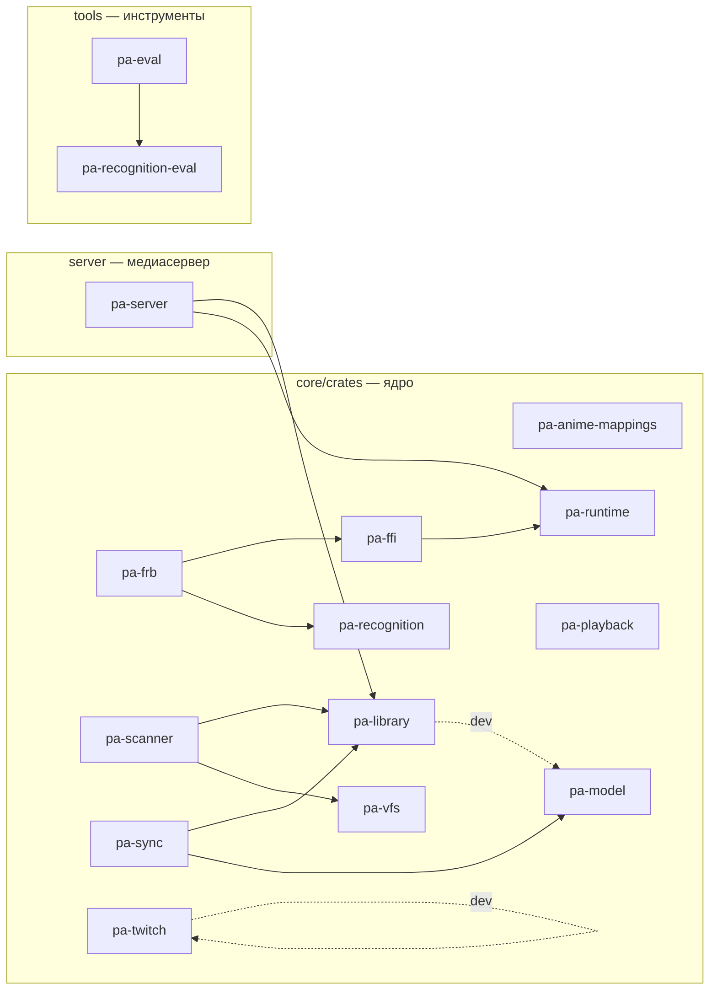

# Граф крейтов workspace

> **Файл генерируется.** Блок между маркерами пересобирает `just docs::crate-graph`
> (скрипт [`scripts/crate_graph.py`](scripts/crate_graph.py) читает `cargo metadata`).
> CI ([`docs.yml`](../../.github/workflows/docs.yml)) запускает `just docs::crate-graph-check` и падает, если граф устарел.
> Руками блок не правят: добавили крейт или зависимость между крейтами — перегенерируйте и закоммитьте.

Показаны только связи между крейтами workspace: сплошная стрелка — обычная зависимость, пунктир — `dev` или `build`. Внешние крейты только подсчитаны в таблице. Целевой (запланированный) состав ядра — в [architecture.md §4](architecture.md#4-ядро-целевой-состав-крейтов).

<!-- BEGIN GENERATED: crate-graph -->

| Крейт | Каталог | Внешних зависимостей | Описание |
|---|---|---|---|
| `pa-anime-mappings` | `core/crates/pa-anime-mappings` | 4 | Anime cross-ID and episode mappings: bundled ODbL data plus runtime-downloaded upstream lists (META-008) |
| `pa-eval` | `tools/crates/pa-eval` | 2 | Offline eval runner for the recognition corpus: metrics, reports, regression check (META-003) |
| `pa-ffi` | `core/crates/pa-ffi` | 3 | UniFFI facade of the project_alpha core: one API for Kotlin and Swift |
| `pa-frb` | `core/crates/pa-frb` | 1 | flutter_rust_bridge facade of the project_alpha core for the Dart package pa_core |
| `pa-library` | `core/crates/pa-library` | 1 | Media library storage: SQLite schema v1, embedded migrations, connection setup (LIB-001) |
| `pa-model` | `core/crates/pa-model` | 1 | Domain types of the project_alpha core: media entities, sync keys, playback state |
| `pa-playback` | `core/crates/pa-playback` | 2 | PlayerEngine contract, capability matrix and Auto engine selection, mock engine and engine contract tests (PLAY-003) |
| `pa-recognition` | `core/crates/pa-recognition` | 1 | Media recognition core (sans-IO): filename parser with N-best hypotheses |
| `pa-recognition-eval` | `tools/recognition-eval` | 2 | Recognition test-corpus format: JSON Schema, taxonomy and validator (META-001) |
| `pa-runtime` | `core/crates/pa-runtime` | 6 | Core runtime of project_alpha: async runtime, lifecycle, data directories, settings store |
| `pa-scanner` | `core/crates/pa-scanner` | 0 | Shallow incremental library scan over pa-vfs into pa-library: listing, (path, size, mtime) diff, soft delete with grace period (LIB-003) |
| `pa-server` | `server` | 8 | Kinolune media server (mode B): axum HTTP on top of the core crates |
| `pa-sync` | `core/crates/pa-sync` | 4 | Serverless state sync: hybrid logical clock, sync operations, LWW merge and the SQLite outbox (SYNC-001) |
| `pa-twitch` | `core/crates/pa-twitch` | 6 | Twitch Helix API client: users, follows, streams, VODs, clips, categories, chat metadata (TWI-001) |
| `pa-vfs` | `core/crates/pa-vfs` | 0 | Virtual file system of media sources: Vfs and ByteSource traits, local backend, backend contract tests |

<!-- END GENERATED: crate-graph -->
