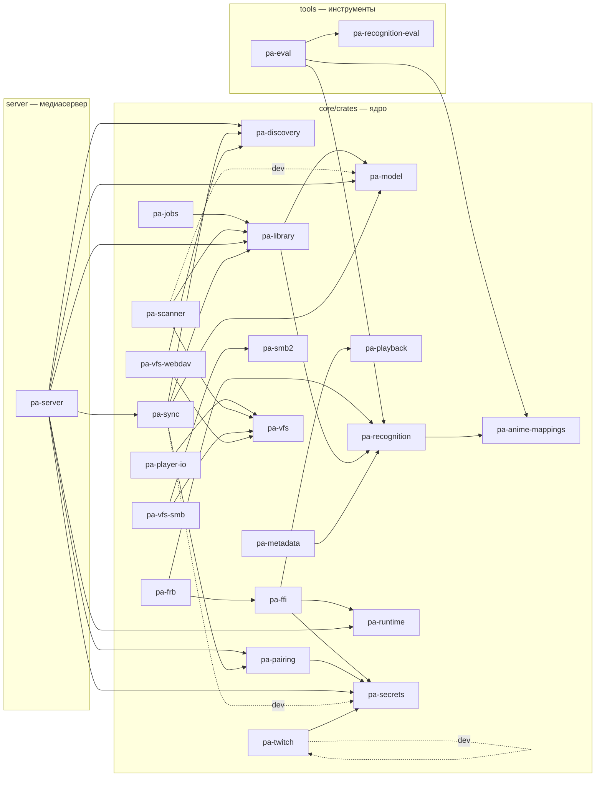

# Граф крейтов workspace

> **Файл генерируется.** Блок между маркерами пересобирает `just docs::crate-graph`
> (скрипт [`scripts/crate_graph.py`](scripts/crate_graph.py) читает `cargo metadata`).
> CI ([`docs.yml`](../../.github/workflows/docs.yml)) запускает `just docs::crate-graph-check` и падает, если граф устарел.
> Руками блок не правят: добавили крейт или зависимость между крейтами — перегенерируйте и закоммитьте.

Показаны только связи между крейтами workspace: сплошная стрелка — обычная зависимость, пунктир — `dev` или `build`. Внешние крейты только подсчитаны в таблице. Целевой (запланированный) состав ядра — в [architecture.md §4](architecture.md#4-ядро-целевой-состав-крейтов).

<!-- BEGIN GENERATED: crate-graph -->

| Крейт | Каталог | Внешних зависимостей | Описание |
|---|---|---|---|
| `pa-anime-mappings` | `core/crates/pa-anime-mappings` | 4 | Anime cross-ID and episode mappings: bundled ODbL data plus runtime-downloaded upstream lists (META-008) |
| `pa-discovery` | `core/crates/pa-discovery` | 4 | LAN discovery over mDNS/DNS-SD: own servers, sync peers, SMB, WebDAV and NFS shares; platform browser hook (NET-009) |
| `pa-eval` | `tools/crates/pa-eval` | 2 | Offline eval runner for the recognition corpus: metrics, reports, regression check (META-003) |
| `pa-ffi` | `core/crates/pa-ffi` | 3 | UniFFI facade of the project_alpha core: one API for Kotlin and Swift |
| `pa-frb` | `core/crates/pa-frb` | 1 | flutter_rust_bridge facade of the project_alpha core for the Dart package pa_core |
| `pa-jobs` | `core/crates/pa-jobs` | 2 | Persistent job queue of the core: priorities, per-type concurrency limits, retries with backoff, pause and cancel, progress events, survives restart (CORE-011) |
| `pa-library` | `core/crates/pa-library` | 1 | Media library storage: SQLite schema v1, embedded migrations, connection setup (LIB-001); progress, Continue watching and Up Next (LIB-011); music library (MUS-001); Twitch data model (TWI-007); FTS5 search (LIB-008) |
| `pa-metadata` | `core/crates/pa-metadata` | 5 | Metadata provider clients outside the sans-IO core: TMDB, AniList, Shikimori, rate limiting, ProviderCache (META-009, META-010) |
| `pa-model` | `core/crates/pa-model` | 1 | Domain types of the project_alpha core: media entities, sync keys, playback state |
| `pa-pairing` | `core/crates/pa-pairing` | 11 | Device family of Kinolune: device keys, pairing by code or QR (SPAKE2), trust store, revocation and family key rotation (SYNC-005) |
| `pa-playback` | `core/crates/pa-playback` | 2 | PlayerEngine contract, capability matrix and Auto engine selection, mock engine and engine contract tests (PLAY-003) |
| `pa-player-io` | `core/crates/pa-player-io` | 0 | ByteSource adapters for players: FFmpeg AVIOContext callbacks and the mpv stream_cb protocol (NET-008) |
| `pa-recognition` | `core/crates/pa-recognition` | 3 | Media recognition core (sans-IO): filename parser with N-best hypotheses, title normalization and local title index, Provider boundary |
| `pa-recognition-eval` | `tools/recognition-eval` | 2 | Recognition test-corpus format: JSON Schema, taxonomy and validator (META-001) |
| `pa-runtime` | `core/crates/pa-runtime` | 6 | Core runtime of project_alpha: async runtime, lifecycle, data directories, settings store |
| `pa-scanner` | `core/crates/pa-scanner` | 1 | Shallow incremental library scan over pa-vfs into pa-library: listing, (path, size, mtime) diff, soft delete with grace period (LIB-003); music tags and index (MUS-001) |
| `pa-secrets` | `core/crates/pa-secrets` | 11 | Secret storage of project_alpha: OS keychains, platform callbacks, encrypted-file fallback, log redaction |
| `pa-server` | `server` | 12 | Kinolune media server (mode B): axum HTTP on top of the core crates |
| `pa-smb2` | `core/crates/pa-smb2` | 1 | Safe Rust wrapper over libsmb2 (LGPL-2.1+) loaded at run time as a shared library (NET-002) |
| `pa-sync` | `core/crates/pa-sync` | 11 | Serverless state sync: hybrid logical clock, sync operations, LWW merge, the SQLite outbox (SYNC-001) and the LAN P2P transport (SYNC-006) |
| `pa-twitch` | `core/crates/pa-twitch` | 6 | Twitch Helix API client (TWI-001) and Device Code Flow sign-in (TWI-002) |
| `pa-vfs` | `core/crates/pa-vfs` | 0 | Virtual file system of media sources: Vfs and ByteSource traits, local backend, backend contract tests |
| `pa-vfs-smb` | `core/crates/pa-vfs-smb` | 0 | SMB2/3 backend of pa-vfs over libsmb2: NTLMSSP, signing, SMB3 encryption, pooled connections, read-ahead with parallel prefetch (NET-003) |
| `pa-vfs-webdav` | `core/crates/pa-vfs-webdav` | 7 | WebDAV backend of pa-vfs: PROPFIND listing, Range reads with read-ahead, Basic and Digest auth, redirects, TLS pinning (NET-004) |

<!-- END GENERATED: crate-graph -->
