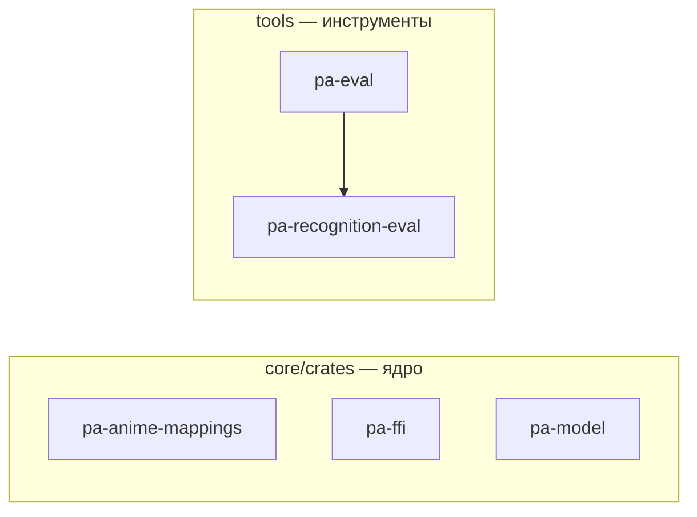

# Граф крейтов workspace

> **Файл генерируется.** Блок между маркерами пересобирает `just docs::crate-graph`
> (скрипт [`scripts/crate_graph.py`](scripts/crate_graph.py) читает `cargo metadata`).
> CI ([`docs.yml`](../../.github/workflows/docs.yml)) запускает `just docs::crate-graph-check` и падает, если граф устарел.
> Руками блок не правят: добавили крейт или зависимость между крейтами — перегенерируйте и закоммитьте.

Показаны только связи между крейтами workspace: сплошная стрелка — обычная зависимость, пунктир — `dev` или `build`. Внешние крейты только подсчитаны в таблице. Целевой (запланированный) состав ядра — в [architecture.md §4](architecture.md#4-ядро-целевой-состав-крейтов).

<!-- BEGIN GENERATED: crate-graph -->

| Крейт | Каталог | Внешних зависимостей | Описание |
|---|---|---|---|
| `pa-anime-mappings` | `core/crates/pa-anime-mappings` | 4 | Anime cross-ID and episode mappings: bundled ODbL data plus runtime-downloaded upstream lists (META-008) |
| `pa-eval` | `tools/crates/pa-eval` | 2 | Offline eval runner for the recognition corpus: metrics, reports, regression check (META-003) |
| `pa-ffi` | `core/crates/pa-ffi` | 1 | UniFFI facade of the project_alpha core: one API for Kotlin and Swift |
| `pa-model` | `core/crates/pa-model` | 1 | Domain types of the project_alpha core: media entities, sync keys, playback state |
| `pa-recognition-eval` | `tools/recognition-eval` | 2 | Recognition test-corpus format: JSON Schema, taxonomy and validator (META-001) |

<!-- END GENERATED: crate-graph -->
