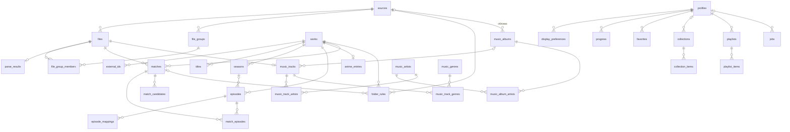

<!-- SPDX-License-Identifier: MPL-2.0 -->

# База медиатеки (SQLite), схема v1

Схема принадлежит крейту [`pa-library`](../../core/crates/pa-library) (`LIB-001`). Одна и та же схема используется клиентами (режим A, база на устройстве) и медиасервером (режим B). Решение и альтернативы — [ADR-0013](../adr/0016-library-sqlite-schema-refinery.md); модель данных — [03 §5](../research/03-metadata-recognition.md#5-модель-данных); устройство ядра — [04 §1.3–1.5](../research/04-backend-architecture-billing.md).

Источник истины — SQL-файлы в [`core/crates/pa-library/migrations/`](../../core/crates/pa-library/migrations). Этот документ описывает смысл таблиц; тест `every_table_is_documented` падает, если у таблицы нет раздела здесь.

## Подключение

```rust
let conn = pa_library::open(path)?;   // создаёт файл, настраивает, мигрирует
let mem = pa_library::open_in_memory()?;
```

`open` выставляет на каждом соединении:

| PRAGMA | Значение | Зачем |
|---|---|---|
| `journal_mode` | `WAL` | читатели не блокируют писателя; хранится в файле |
| `foreign_keys` | `ON` | в SQLite по умолчанию выключены; **ставится на каждое соединение** (`pa_library::configure`) |
| `synchronous` | `NORMAL` | в режиме WAL безопасно при сбое процесса, быстрее `FULL` |
| `busy_timeout` | 5 с | второй писатель ждёт, а не получает `SQLITE_BUSY` |

SQLite собирается из исходников (`rusqlite` с `bundled`, public domain), поэтому версия одинакова на всех платформах, и доступны `STRICT`-таблицы и `json_valid()`.

## Миграции

- Раннер свой, ~80 строк в `pa-library` (`migrate`); refinery убран в `LIB-016` из-за уязвимого встроенного SQLite (ADR-0016, поправка).
- Файлы `migrations/YYYYMMDDHHMM_<ID>_<slug>.sql`. Метка времени — номер версии миграции, поэтому ветки, слитые в любом порядке, не требуют перенумерации. `PRAGMA user_version` не используется: 32-битное поле не вмещает метку времени.
- Новый файл добавляется в список `MIGRATIONS` (`src/migrations.rs`); тест сверяет список с каталогом.
- Применённую миграцию **не редактируют**: история `pa_schema_history` (`version`, `name`, `applied_on`, `checksum`) хранит контрольную сумму SQL (FNV-1a 64), и `migrate` откажется работать (`Error::ChecksumMismatch`).
- Все ожидающие миграции применяются **одной транзакцией**: сбой посередине не оставляет полусхему.
- Проверки истории перед запуском:
  - в файле есть таблицы, но нет истории → `Error::ForeignDatabase` (в том числе база pa_library v0), файл не меняется;
  - в истории есть неизвестная версия старше нашей последней → `Error::UnknownMigration` (истории разошлись);
  - наша миграция старше последней применённой, но не применена → `Error::OutOfOrder` (переименуйте файл в более позднюю метку);
  - в истории есть версии новее наших → база от более новой сборки: работаем, `MigrationReport::db_is_newer = true`. Это допустимо благодаря правилу expand→contract (`LIB-002`): новая версия только добавляет, удаление — через версию.
- Изменения схемы — только expand→contract (`LIB-002`). Пересборку таблицы (SQLite не умеет `ALTER … DROP CONSTRAINT`) делают внутри транзакции с `PRAGMA defer_foreign_keys = ON`.

## Соглашения

- Имена таблиц — во множественном числе, `snake_case` (так `matches` не конфликтует с оператором `MATCH`).
- Все таблицы `STRICT`: в `INTEGER` нельзя записать строку.
- `id INTEGER PRIMARY KEY` — локальный rowid (`pa_model::RowId`), **между устройствами не синхронизируется**. Для синхронизации — `media_key` (текстовая форма `pa_model::MediaKey`: `file:<fp>`, `tmdb:movie:<id>`, `tmdb:episode:<show>:<s>:<e>`, `mb:recording:<mbid>`, `twitch:vod|rec|clip:<id>`) и `profiles.sync_id`.
- Время — Unix-миллисекунды в столбцах `*_at_ms`; длительности и позиции — `*_ms`.
- Логические значения — `INTEGER` 0/1 с `CHECK`.
- JSON-столбцы (`*_json`, `audio_langs`, `sub_langs`) проверяются `json_valid()`.
- **Закрытые перечисления** повторяют serde-имена `pa-model` (`WorkKind`, `AnimeType`, `NumberingScheme`, `EpisodeType`, `MediaKind`) и защищены `CHECK (x IN (…))`; тесты вставляют каждый вариант из `pa-model`. Добавить значение = пересобрать таблицу, поэтому так сделаны только стабильные наборы.
- **Открытые наборы** (провайдеры, виды источников, типы задач, источники маппингов) защищены только проверкой «строчный slug» `[a-z0-9_]+`; новое значение не требует миграции.
- Для каждого внешнего ключа есть индекс по его столбцам (тест `foreign_key_columns_are_indexed`), иначе каскадное удаление сканирует дочернюю таблицу.
- Пароли и токены в базу не попадают: у источника только `credential_ref` — ключ записи в Keychain/Keystore/Secret Service.

## Связи



Что удаляется каскадом:

| Удаляем | Уходит вместе | Остаётся |
|---|---|---|
| источник | файлы, группы, результаты парсинга, матчи, правила папок, музыкальные треки | каталог (`works`…), прогресс и избранное (они по `media_key`); альбомы, артисты и жанры — до `music::remove_orphans`, ссылка обложки на источник → `NULL` |
| произведение | внешние ID, названия, сезоны, эпизоды, маппинги, матчи, правила папок, предпочтения, избранное и элементы коллекций этого произведения | файлы (становятся нераспознанными); `anime_entries.relation_*` → `NULL` |
| матч | эпизоды матча, кандидаты | правило папки (`created_from_match_id` → `NULL`) |
| профиль | предпочтения, прогресс, избранное, его коллекции и плейлисты | задачи (`owner_profile_id` → `NULL`) |

## Таблицы

### Источники и файлы

### `sources`

Место, которое сканирует медиатека: локальная папка, SMB/NFS/WebDAV-шара, свой сервер, Plex/Jellyfin/Emby. `kind` — открытый набор (`local`, `smb`, `nfs`, `webdav`, `server`, `plex`, `jellyfin`, `emby`…). `uri` — корень без учётных данных. `credential_ref` — ключ секрета в хранилище ОС (`NET-011`); сам пароль в базе не хранится. В режиме A источник выполняет роль «библиотеки» из 03 §5 (`library_id`).

### `files`

Файл в источнике. `path` — POSIX-путь относительно корня источника, уникален в пределах источника и **никогда не синхронизируется** (04 §1.8). Технические поля заполняют сканер (`LIB-003`: `size_bytes`, `mtime_ms`, `inode`), анализ контейнера (`LIB-006`: `container`, `duration_ms`, `video_json`, `audio_langs`, `sub_langs`, `embedded_tags_json`) и хэши (`LIB-004`: `fingerprint` — основа ключа `file:`, `oshash`, `ed2k`, `crc32`; `crc32_in_name` — CRC из имени релиза). `missing_since_ms` — мягкое удаление с grace-периодом.

### `file_groups`

Структурная группа файлов (`LIB-007`): папка сериала, папка фильма, диск (BDMV, VIDEO_TS) или «россыпь». `skeleton` — нормализованный «скелет» имени релиза для крауд-маппинга (03 §4.8).

### `file_group_members`

Файл в группе с ролью: `main`, `part` (с `part_no` для cd1/cd2), `extra` (с `extra_type`: trailer, featurette, NCOP…), `sample`, `subtitle`, `nfo`, `art`.

### `parse_results`

N-best гипотезы парсера имён (`META-005`) для файла и версия парсера; при новой версии парсера результаты пересчитываются.

### Каталог

### `works`

Каноническое произведение, не зависящее от провайдера: `movie`, `show` или `anime` (`pa_model::Work`). `anime_type` — только для `anime` (`CHECK`). Внешние ID и названия вынесены в отдельные таблицы.

### `external_ids`

ID произведения у провайдеров. Ключ `(provider, ext_kind, ext_id)` уникален глобально: один TMDB ID — одно произведение. `ext_kind` — тип сущности внутри провайдера (TMDB `movie`/`tv`, TVDB `series`), пустая строка, если у провайдера типов нет. Соответствие `pa_model::ExternalIds`: `tmdb = "tv:1399"` ↔ `('tmdb', 'tv', '1399')`, `anidb = 42` ↔ `('anidb', '', '42')`. Один ID каждого типа на произведение (`UNIQUE (work_id, provider, ext_kind)`).

### `titles`

Названия произведения на разных языках и письменностях: `main`, `official`, `synonym`, `short`, `romaji`; `source` — откуда взято. Основа поиска (`LIB-008`, раздел «Поиск»).

### `seasons`

Сезон в конкретной схеме нумерации (`NumberingScheme`); `number = 0` — спешлы. Для `tmdb_group` в `scheme_ref` лежит ID группы эпизодов TMDB (для остальных схем — пусто, `CHECK`).

### `episodes`

Эпизод в каноническом пространстве. `canonical_ref` — AniDB eid или TMDB episode id. Номера `season_number`/`episode_number` — в порядке TMDB, когда он известен; остальные порядки — в `episode_mappings`. `season_id` при удалении сезона обнуляется.

### `episode_mappings`

Проекция эпизода в другие порядки (TVDB aired/DVD/absolute, AniDB, группа TMDB): номер, часть разделённого эпизода (`part`, 0 — целиком), источник маппинга (`anime_lists`, `tvdb`, `tmdb_group`, `thexem`, `user`…) и уверенность. Индекс `episode_mappings_lookup` отвечает на вопрос «какой эпизод в схеме X имеет номер S/E».

### `anime_entries`

AniDB-часть аниме-произведения: `anidb_aid`, франшиза (`franchise_id` связывает S1/S2/фильмы) и соседи по хронологии (`relation_prev`/`relation_next`).

### Распознавание

### `matches`

Решение «файл → произведение (и эпизоды)»: схема нумерации, откалиброванная `confidence`, состояние (`auto`, `auto_review`, `user_confirmed`, `user_set`, `rejected`), кто решил (`rule`, `hash_*`, `nfo`, `embedded`, `scorer`, `llm`, `user`), признаки и объяснение в JSON и версия модели — чтобы пересчитать матчи при новой модели. Живой (не `rejected`) матч у файла не больше одного (`matches_live_file`); отклонённые остаются как история и как отрицательные примеры.

### `match_episodes`

Эпизоды матча в порядке следования в файле. Мультиэпизодный файл (A9) — несколько строк. Заменяет `episode_ids_json` из 03 §5, чтобы на эпизоды работали внешние ключи.

### `match_candidates`

Альтернативы матча для UI исправления: произведение, `score`, `rank` (1 — лучшая альтернатива после выбранной).

### `folder_rules`

Исправление пользователя, применяемое ко всей папке: префикс пути в источнике → произведение, схема, сдвиг номеров, принудительный сезон или тип. `created_from_match_id` — матч, из которого правило родилось.

### Кэш провайдеров

### `provider_cache`

Ответы провайдеров метаданных: `(provider, endpoint, key)` → `payload` (байты, обычно JSON), `etag`, время получения и TTL. Срок жизни данных TMDB (не дольше 6 месяцев по условиям) обеспечивает код очистки по `fetched_at_ms`.

### Профили и состояние пользователя

### `profiles`

Профиль домочадца. Профиль `id = 1`, `sync_id = 'default'` создаётся миграцией, чтобы прогресс работал без настройки; пустое `name` UI показывает локализованным «Основной». `sync_id` — стабильный ID профиля между устройствами. PIN, ограничения и белые списки добавит `LIB-012` (expand).

### `display_preferences`

Какой порядок эпизодов профиль видит у произведения (например, TVDB DVD вместо TMDB).

### `progress`

Состояние воспроизведения (`pa_model::PlaybackItem`) по профилю и `media_key`: позиция, длительность, «просмотрено», время и устройство последнего изменения. Ключ — `media_key`, а не `file_id`, поэтому прогресс переживает пересканирование, переезд файла и общий для копий на разных источниках. Индекс `progress_recent` — для ряда «Продолжить просмотр» (`LIB-011`). Слияние между устройствами (HLC, LWW) — `pa-sync`.

Логика — модуль `pa_library::progress` (`LIB-011`): «в процессе» — от 2 % до 95 % длительности включительно (пороги настраиваются, `Thresholds`), позиция дальше 95 % ставит `watched`; «просмотрено» монотонно — его снимает только явное «Отметить непросмотренным» (позиция сбрасывается в 0). Ряд «Продолжить» — по `updated_at_ms`, объединяет фильмы, эпизоды, нераспознанные видео и Twitch VOD и записи (live сюда не попадает: у него нет позиции); Up Next — следующий непросмотренный эпизод с файлом после последнего досмотренного обычного эпизода (через границу сезона; спешлы его не сдвигают). Колонка `hidden_at_ms` (миграция `202611141400_LIB-011_progress_hidden`) — «Убрать из ряда»: строка скрыта, пока `hidden_at_ms >= updated_at_ms`, следующее воспроизведение возвращает её; это локальное состояние устройства, sync-операции для него пока нет. Локальные изменения в той же транзакции передаются в `ProgressSink` — его реализует `pa_sync::Replica` (операции `progress.upsert`, `watched`, `unwatch` в `sync_outbox`); полученные операции пишет `progress::apply_remote` (`Replica::receive_into`).

### `favorites`

Избранное профиля: либо воспроизводимый элемент (`media_key`), либо произведение (`work_id`, например сериал целиком) — ровно одно из двух (`CHECK`).

### `collections`

Коллекции: `manual` (составлена руками), `smart` (сохранённый фильтр в `rule_json`, `LIB-009`) или `external` (импорт, например коллекция TMDB, `external_ref = 'tmdb:collection:10'`). `profile_id = NULL` — общая для всех профилей.

### `collection_items`

Элементы коллекции по порядку: произведение или воспроизводимый элемент.

### `playlists`

Плейлисты профиля: `audio` (музыка) или `video` (P1).

### `playlist_items`

Элементы плейлиста по порядку, по `media_key` — плейлист переживает пересканирование и переносится между устройствами.

### Задачи

### `jobs`

Персистентная очередь `pa-jobs` (`CORE-011`, 04 §1.10): тип (открытый набор: `library_scan`, `metadata_refresh`, `offline_copy`, `transcode_optimize`, `cleanup`, Twitch-задачи в full-сборках), приоритет, состояние из конечного автомата (`queued`, `waiting_resources`, `running`, `paused`, `retrying`, `done`, `failed`, `cancelled`), прогресс и байты, попытки, время следующего запуска, параметры и результат в JSON. `target_storage` станет ссылкой на `storage_targets`, когда их введёт `CORE-012`. Частичный индекс `jobs_pending` — для выбора следующей задачи.

### Синхронизация

### `sync_outbox`

Офлайн-очередь `pa-sync` (`SYNC-001`, 04 §1.8.1; миграция `202611141200_SYNC-001_sync_outbox`): локальные sync-операции, которые ещё не подтвердил ни один узел или хаб. `op_id` — UUIDv7 операции (уникален, по нему дедуплицируют получатели, повторная постановка игнорируется), `payload` — `pa_model::Versioned<pa_sync::Op>` в JSON, `op` и `hlc` — для диагностики. Неудачная отправка увеличивает `attempts` и переносит `next_attempt_at_ms` с экспоненциальной задержкой (1 с … 5 мин); операции не выбрасываются. Подтверждённая операция удаляется. Пароли и токены сюда не попадают: `pa-sync` отклоняет секретные настройки.

### Музыка

Миграция `202611141600_MUS-001_music_library` (`MUS-001`, 01 §4.11). Один аудиофайл из `files` — один трек. Теги читает `pa-scanner` (`index_music`, крейт `lofty`: ID3v2/ID3v1, Vorbis Comments, MP4 ilst, APE, RIFF INFO; DSF — ID3v2 по указателю из заголовка), пишет `pa_library::music`. Артисты, альбомы и жанры общие для всех источников; строки без треков удаляет `music::remove_orphans` после каждого прохода. Имена сравниваются по «свёрнутому» ключу: нижний регистр, одиночные пробелы.

Группировка в альбомы (`album_key`): MusicBrainz release id → `mb:<id>`; иначе тег альбомного артиста (или флаг сборника — как «Various Artists») и название → `aa:<артист>|<название>`, такой альбом собирается из разных папок и источников; иначе папка альбома и название → `dir:<источник>:<папка>|<название>`. Подпапки дисков (`CD1`, `Disc 2`) относятся к папке альбома выше. `music::refresh_album` пересчитывает альбом по трекам: альбомные артисты — самый частый тег альбомного артиста; без него — «Various Artists» при флаге сборника, единственный основной артист треков или «Various Artists» со сборником, если основных артистов несколько. Год — самый частый год треков, число дисков — максимум из номеров и `disc_total`.

Обложка альбома: картинка в папке альбома (`cover`, `folder`, `front`, `album`, `albumart` — `.jpg`, `.jpeg`, `.png`, `.webp`), иначе встроенная картинка первого трека, в котором она есть (`pa_scanner::read_embedded_art`). Сами картинки в базу не копируются.

### `music_artists`

Артисты: имя, имя для сортировки (`ARTISTSORT`), MusicBrainz id; уникальный `name_key`. Один артист и для треков, и для альбомов, и для композиторов.

### `music_albums`

Альбомы: ключ группировки, название, год, флаг сборника, число дисков, MusicBrainz release и release group, обложка (`art_kind` = `embedded` | `folder`, источник и путь).

### `music_album_artists`

Альбомные артисты по порядку.

### `music_tracks`

Трек файла (`file_id` уникален): название (без тега — имя файла), диск и трек с общим числом, год, исходные тег альбомного артиста и флаг сборника (вход группировки), MusicBrainz recording id (ключ синхронизации `mb:recording:`), свойства потока (кодек, lossless, частота, разрядность, каналы, битрейт, длительность), ReplayGain трека и альбома (дБ и линейный пик; `R128_*_GAIN` у Opus приводятся к опорному уровню ReplayGain −18 LUFS: `gain/256 + 5`), есть ли встроенная обложка, `tags_failed` (теги не прочитаны, данные из пути). `tagged_size_bytes` и `tagged_mtime_ms` — состояние файла при чтении тегов: если `files` изменился, `music::stale_files` вернёт файл снова.

### `music_track_artists`

Артисты трека по порядку (`role = artist`, первый — основной) и композиторы (`role = composer`).

### `music_genres`

Жанры, уникальные по `name_key`.

### `music_track_genres`

Жанры трека по порядку.

### Поиск

Миграция `202611141800_LIB-008_search_index` (`LIB-008`, [ADR-NNNN](../adr/NNNN-library-search-fts5.md)), логика — модуль `pa_library::search`. Ключи поиска считает Rust (`pa_recognition::title::normalize`: свёртка регистра и диакритики, римские цифры, транслит кириллицы в общее латинское пространство), поэтому SQL-триггеры только ставят изменённую сущность в очередь, а `search::sync` пересобирает её документы. `search::search` сам вызывает `sync`, если очередь не пуста; сканеру стоит вызывать `sync` после партии, чтобы первый поиск был быстрым. `search::rebuild` пересобирает индекс целиком (после смены правил нормализации).

Что индексируется: произведения (`works.title`, `original_title`, все `titles`; год — дополнительным токеном), эпизоды (`title`), нераспознанные видео (файл без живого матча и без музыкального трека, с видеорасширением, не помеченный пропавшим: имя без расширения и имя папки), артисты (имя, имя для сортировки), альбомы и треки (название, а также «артист + название»), коллекции (`name`; чужие коллекции профиля отсекаются при выдаче). Люди и Twitch добавятся, когда появятся их таблицы.

Запрос: каждое слово ищется в ключе *plain* или *loose*, последнее — как префикс (поиск по мере ввода; недопечатанное слово в другой письменности укорачивается: `ирони` → `iron*`). Кандидаты из FTS5 (bm25) и из точного и префиксного поиска по ключам ранжируются в Rust: точное название > начинается с запроса > слова где-то в названии, затем доля названия, покрытая запросом, вес алиаса и вид результата. Один результат на сущность; `search::group` группирует по виду.

### `search_docs`

Документ поиска: одна строка сущности (название, алиас, имя файла). `entity` + `ref_id` — сущность-источник (`work`, `episode`, `file`, `artist`, `album`, `track`, `collection`; полиморфная ссылка, без внешнего ключа), `kind` — группа результата (`movie`, `show`, `anime`, `episode`, `video`, `artist`, `album`, `track`, `collection`; открытый набор). `text` — исходная строка, `plain_key` и `loose_key` — токены через пробел (по ним точный и префиксный поиск через индексы), `weight` — вес строки внутри сущности (основное название 1,0, алиасы меньше).

### `search_fts`

Contentless FTS5-индекс (`contentless_delete = 1`, префиксные индексы на 2 и 3 символа) над `search_docs`, `rowid = search_docs.id`. Колонки `plain` (ключ plain и год произведения) и `loose` (ключ loose и всё название без пробелов: `spiderman`). Токенизатор `unicode61` без снятия диакритики: токены уже нормализованы в Rust. Служебные таблицы `search_fts_*` создаёт SQLite.

### `search_queue`

Сущности, чьи документы нужно пересобрать (`entity`, `ref_id`). Заполняется триггерами `search_*` на `works`, `titles`, `episodes`, `files`, `matches`, музыкальных таблицах и `collections` (в том числе при каскадном удалении), очищается `search::sync`.

## Что не входит в v1

Добавят задачи-владельцы новыми миграциями: Twitch (стримеры, VOD, записи; `TWI-*`), поля профилей (`LIB-012`), места хранения (`CORE-012`), учётные записи сервера (`SRV-*`). Таблица `CrowdHash` из 03 §5 не нужна: своих серверов у проекта нет (ADR-0004).

## Переход с pa_library v0

Релиз 0.1 работает на Dart-пакете `clients/flutter/packages/pa_library` (`R01-LIB`) со своей упрощённой базой (`PRAGMA user_version = 1`; таблицы `sources`, `items`, `progress`, `tmdb_cache`, `settings`; строковые ID — усечённый SHA-1 пути). Rust-библиотека её **не мигрирует на месте**:

1. Новая база — **отдельный файл** рядом со старым. `pa_library::migrate` на файле v0 возвращает `Error::ForeignDatabase { legacy_v0: true }` и ничего не меняет; `pa_library::is_legacy_v0` распознаёт такой файл.
2. Импорт (задача `LIB-015`) читает v0 только на чтение и переносит данные; после успеха старый файл переименовывается в `*.v0.bak` и удаляется следующим релизом.
3. Соответствие:

| v0 | v1 |
|---|---|
| `sources(id, kind, name, path, username)` | `sources(kind: localFolder→local, smb; name; uri: путь → file:// URI; username)`; пароль остаётся в secure storage, его ключ — в `credential_ref` |
| `items` `kind = movie` | `files` (путь относительно корня источника) + `works(kind = movie)` + `external_ids('tmdb','movie',tmdb_id)` + `matches(decided_by = scorer`, `state = user_set`, если `locked = 1`) |
| `items` `kind = show` | `works(kind = show)` + `external_ids('tmdb','tv',tmdb_id)` |
| `items` `kind = episode` | `files` + `episodes(season_number, episode_number)` у произведения из `show_id` + `matches` + `match_episodes` (несколько, если задан `episode_end`) |
| `items` `kind = track` | `files`; теги — в `embedded_tags_json` до появления музыкальных таблиц (`MUS-*`) |
| `items.parsed_*` | `parse_results` (одна гипотеза) |
| `progress(item_id, …)` | `progress(profile_id = 1, media_key)`: `tmdb:movie:<id>` / `tmdb:episode:<show>:<s>:<e>` для распознанных; для остальных — `file:<fingerprint>` после хэширования файла (`LIB-004`), до тех пор запись ждёт в импорте |
| `tmdb_cache` | не переносится (кэш, восстанавливается сам) |
| `settings` | в конфигурацию приложения (`CORE-006`), не в медиатеку |
