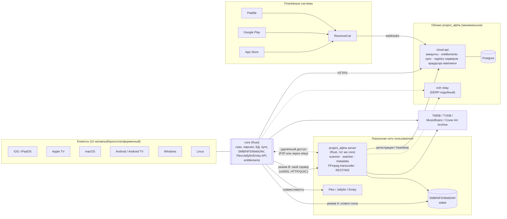
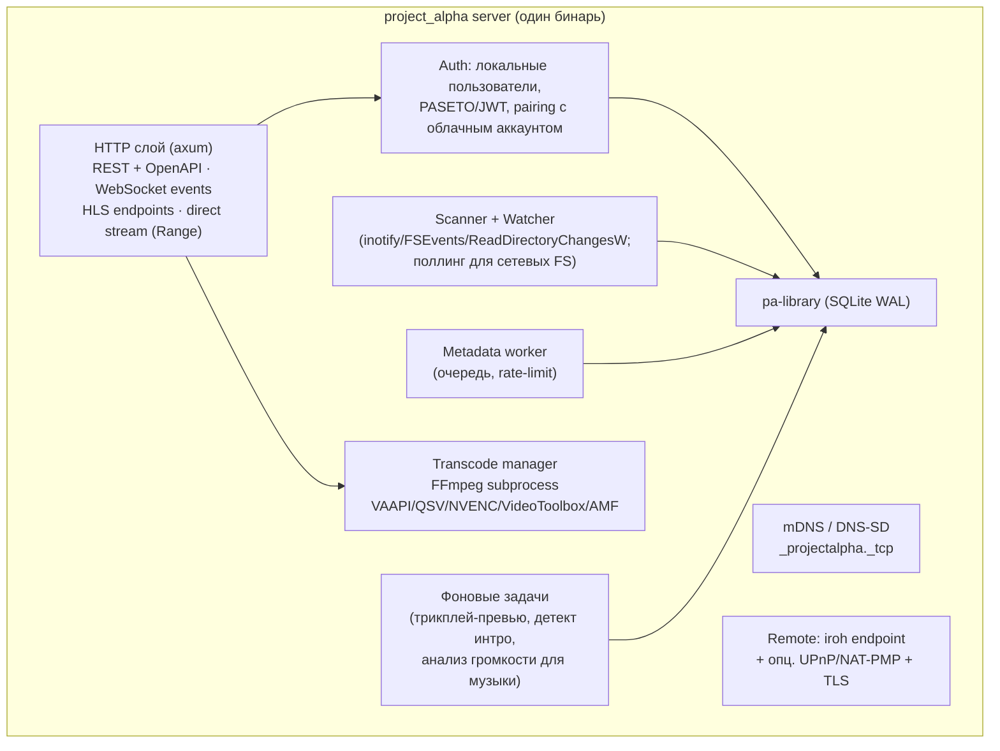
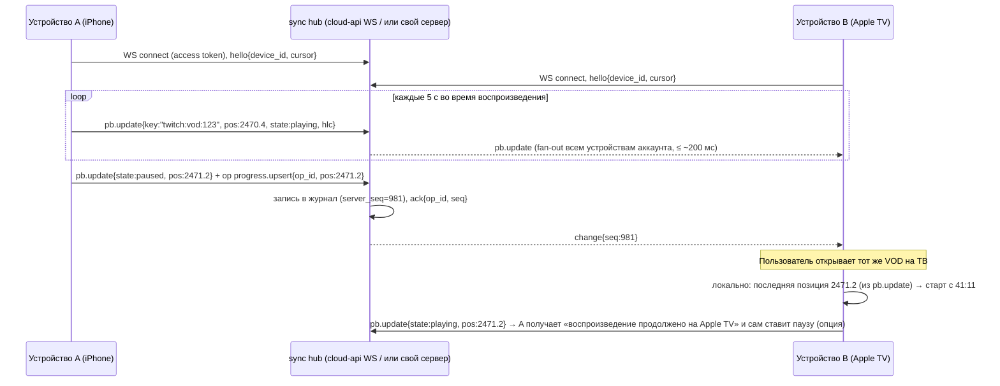
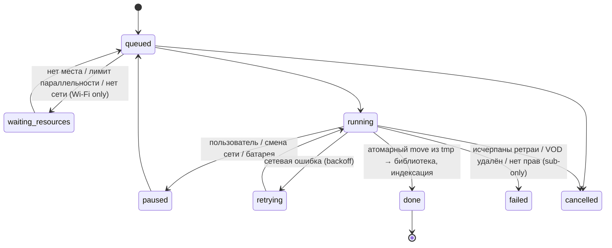
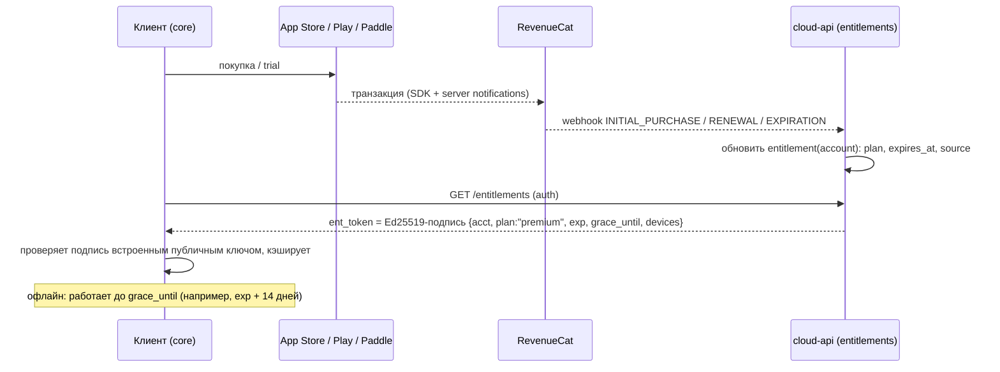
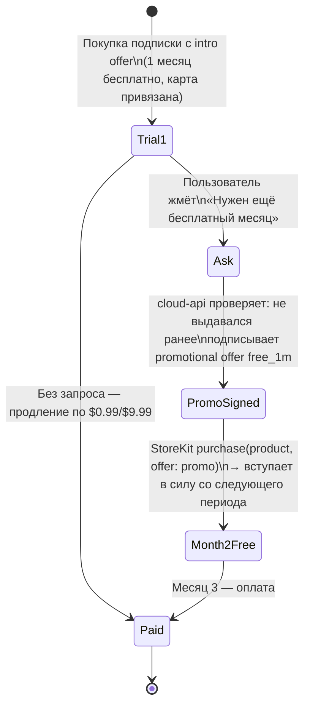
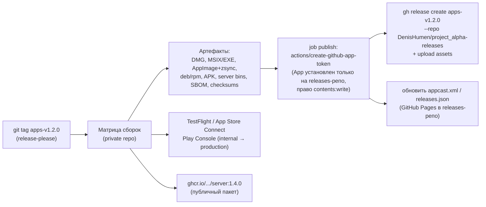

# 04. Бэкенд-архитектура, аккаунты/лицензии/биллинг, репозиторий и CI/CD

> Исследование для project_alpha. Дата: 2026-11-13. Автор: исследователь №4 (бэкенд, биллинг, репо/CI).
> Цифры по комиссиям и ценам на сторонние сервисы перед запуском перепроверить по первоисточникам: часть данных взята из вторичных источников (ссылки ниже).

---

## 0. TL;DR

- **Общее ядро на Rust** (`core/`): сканер, парсер имён, клиенты SMB/NFS/WebDAV, БД библиотеки (SQLite), метадата, синхронизация, клиенты Plex/Jellyfin/Emby. В клиенты встраивается через **UniFFI** (Swift/Kotlin) и C ABI. На этом же ядре работает **сервер** (`server/`, axum + tokio).
- **Сервер**: один бинарь, SQLite в режиме WAL (без Postgres), FFmpeg как внешний процесс с HW-ускорением, HLS/fMP4 для транскодинга, direct play/direct stream по HTTP Range, REST + OpenAPI + WebSocket для событий, обнаружение через mDNS, удалённый доступ через **iroh** (QUIC, hole punching + relay) и опционально проброс портов с TLS.
- **Twitch-модуль учтён**: почти мгновенная синхронизация позиции через WebSocket-hub (heartbeat 5 с, fan-out, HLC LWW, офлайн outbox) с единым ключом `twitch:vod:<id>` для онлайн и скачанных VOD; общая очередь задач `pa-jobs` (загрузка/запись/транскод) с квотами и retention; токены Twitch — отдельно на каждое устройство в Keychain/Keystore, у сервера — свой токен, облако их не хранит.
- **Облако минимальное**: один сервис (Rust/axum) + Postgres на VPS Hetzner или аналогичном (≈ $10–30/мес на старте). Задачи: аккаунты, entitlement (права), синхронизация прогресса, краудсорс-маппинги, регистрация серверов и relay. Своё облако, **без CloudKit** (нужны Android/Linux/Windows).
- **Биллинг**: App Store и Google Play IAP на мобильных/TV, **Paddle** (merchant of record) на десктопе, **RevenueCat** как объединитель прав на старте (бесплатно до $2.5k MTR), со своим entitlement-сервисом поверх него.
- **«Второй бесплатный месяц»**: iOS — подписанный **promotional offer** «1 месяц бесплатно» (вступает в силу со следующего продления); Android — **`subscriptionsv2.defer`** на 30 дней; десктоп — просто продлеваем trial на своём сервере.
- **Главный риск — $0.99/мес**: на Paddle теряем ~55% ($0.44 чистыми), на App Store ~15–30% + НДС. Рекомендация: на десктопе месячный план не продавать (или продавать квартал/год), основной упор на $9.99/год и lifetime.
- **Монорепо** в приватном репо, trunk-based, Conventional Commits, release-please, GitHub Actions; артефакты публикуются в `project_alpha-releases` через **GitHub App token**. Автообновления: Sparkle 2 (macOS), Velopack или WinSparkle (Windows), AppImage + zsync (Linux), Flathub опционально.

---

## 1. Архитектура системы

### 1.1. Общая схема



Ключевая идея: **режим A и режим B — это один и тот же код**. Клиент в режиме A — это «встроенный сервер без HTTP»: тот же сканер, та же схема БД, тот же метадата-пайплайн, просто запущенные внутри приложения. Сервер в режиме B — то же ядро плюс HTTP-слой, watcher, транскодер и мультипользовательность. Это даёт паритет функций и половину тестов бесплатно.

### 1.2. Язык общего ядра: Rust vs Go vs Kotlin Multiplatform

| Критерий | **Rust** | Go | Kotlin MP |
|---|---|---|---|
| Встраивание в iOS/tvOS | Статическая библиотека + UniFFI → Swift. Отлично, tvOS поддерживается (tier 3 target, но собирается; используется в проде) | gomobile: тяжёлый рантайм (GC, горутины), ~+10–20 МБ, проблемы с tvOS, медленный FFI, gomobile плохо поддерживается | Kotlin/Native → framework. Работает, но рантайм, GC, сложнее отладка, медленная сборка; tvOS — да |
| Android | `cargo-ndk` + UniFFI → Kotlin. Отлично | gomobile/AAR, работает | Нативно (JVM) — идеально |
| Desktop (Win/macOS/Linux) | Нативно, C ABI, легко встраивается в любой UI (Qt, Flutter через FRB, Tauri, Swift, C#) | Нормально через cgo/C ABI, но GC и сигналы мешают при встраивании | Только JVM или Kotlin/Native; Compose Desktop тянет JVM |
| Сервер | axum/tokio — отличная производительность, низкая память (важно для NAS) | Отлично, проще всех | Ktor/JVM — тяжелее по памяти для NAS |
| FFmpeg/libmpv биндинги | `ffmpeg-next`, `rsmpeg`, `libmpv-rs` | cgo, приемлемо | Сложно |
| SMB клиент | Нужно либо `libsmb2` (C, через FFI), либо `smb`-крейты (сырые); надёжнее libsmb2 | `go-smb2` — зрелый, чистый Go | Нет нормального на всех платформах |
| Работа с AI-агентами | Компилятор ловит большую часть ошибок, которые генерирует агент — сильный плюс для команды «1 человек + агенты» | Просто, но меньше гарантий | Средне |

**Решение: Rust.** Причины: единственный вариант, который одинаково хорошо встраивается во все 6 клиентских платформ *и* даёт лёгкий сервер для слабых NAS (ARM, 1–2 ГБ RAM). Минусы — порог входа и время компиляции — компенсируются тем, что код пишут в основном агенты, а строгий компилятор служит «бесплатным ревьюером».

Рекомендуемый стек ядра:
- `tokio` (async), `rusqlite` или `sqlx` (SQLite), `refinery`/`sqlx migrate` для миграций;
- **UniFFI** для биндингов Swift/Kotlin ([mozilla/uniffi-rs](https://github.com/mozilla/uniffi-rs)); для Flutter-клиента (если выберут) — `flutter_rust_bridge`;
- SMB: **libsmb2** через FFI (используется в VLC/Kodi), NFS: **libnfs** (тот же автор), WebDAV: `reqwest` + свой PROPFIND-клиент;
- воспроизведение — **не в ядре**: плеер (libmpv / AVPlayer / ExoPlayer/Media3 / FFmpeg-based) — область другого исследователя; ядро отдаёт плееру URL или поток (для SMB — локальный HTTP-прокси внутри приложения на `127.0.0.1`, так делает Infuse-подобный софт, чтобы любой плеер мог читать SMB как HTTP с Range).

### 1.3. Структура ядра (crates)

```
core/
  crates/
    pa-model/        # доменные типы: Movie, Episode, Track, Album, MediaFile, Stream
    pa-parse/        # парсинг имён файлов (S01E02, год, качество), NFO, sidecar-субтитры
    pa-vfs/          # абстракция FS: local, smb (libsmb2), nfs (libnfs), webdav, plex/jf/emby
    pa-probe/        # ffprobe-подобный анализ (через libavformat) — кодеки, дорожки, длительность
    pa-library/      # схема SQLite, миграции, запросы, FTS5-поиск
    pa-scanner/      # инкрементальный скан, хэши, дедупликация, детект изменений
    pa-metadata/     # провайдеры TMDB/TVDB/MusicBrainz/CAA/fanart, кэш, маппинги
    pa-sync/         # прогресс просмотра, CRDT/LWW, очередь офлайн-изменений, клиент cloud-api
    pa-remote/       # клиенты Plex/Jellyfin/Emby + клиент своего сервера (REST/WS) + iroh
    pa-entitlement/  # проверка подписанных токенов прав, trial-логика, кэш офлайн
    pa-jobs/         # персистентная очередь задач: загрузки, запись live, транскод, cleanup (1.10)
    pa-twitch/       # Helix API, EventSub, OAuth-токены, HLS VOD/live (детали — док. по Twitch)
    pa-proxy/        # локальный HTTP-прокси (SMB/NFS → HTTP Range) для плееров
    pa-ffi/          # UniFFI-фасад: единый API для Swift/Kotlin/C
```

### 1.4. Режим A: клиент-онли (SMB/NFS/WebDAV)

1. Пользователь вводит `smb://nas.local/media` (или выбирает из mDNS/NetBIOS-обнаруженных хостов), логин/пароль → в Keychain/Keystore.
2. `pa-scanner` обходит дерево через `pa-vfs`, для каждого файла: путь, размер, mtime → запись в SQLite. Быстрый «поверхностный» скан (только листинг) → библиотека появляется за секунды; затем фоновый `probe` (чтение первых ~2–8 МБ для заголовков контейнера) и метадата.
3. Повторный скан инкрементальный: сравнение `(path, size, mtime)`; на SMB нет надёжных уведомлений об изменениях для всех серверов → пересканирование по таймеру/при открытии/по pull-to-refresh. (SMB2 CHANGE_NOTIFY можно использовать как оптимизацию, где поддерживается.)
4. Метадата: из облака сначала берём **краудсорс-маппинг** (хэш имени/размера → TMDB ID), иначе — локальный матчинг + запрос к TMDB. Картинки кэшируются локально (LRU с лимитом).
5. Особенность tvOS: нет постоянного хранилища большого объёма (кэш может вычищаться системой) → на Apple TV БД держим в Application Support (сохраняется, но ограничена) и картинки — в Caches; для больших библиотек рекомендовать режим B или синхронизацию библиотеки с другого устройства через облако (см. 1.8).

Каждое устройство в режиме A строит библиотеку **само**. Чтобы не сканировать одну и ту же шару на 4 устройствах, есть опция «поделиться библиотекой» — экспорт снапшота БД (без путей-секретов) через облако или по LAN с другого своего устройства. Это v2.

### 1.5. Режим B: собственный медиасервер



**Компоненты:**

- **Scanner/Watcher.** Локальные диски: `notify`-крейт (inotify/FSEvents/ReadDirectoryChangesW) с дебаунсом. Сетевые маунты (CIFS/NFS в Linux) событий не дают надёжно → периодический инкрементальный скан. На нашем NAS-дистрибутиве медиа лежит локально → watcher работает идеально.
- **БД: SQLite (WAL) по умолчанию, Postgres не нужен.** Обоснование: один процесс-писатель, десятки тысяч—сотни тысяч записей, бэкап = копия файла, нулевая админка на NAS. Jellyfin и Plex тоже на SQLite. Абстрагировать слой хранения через трейт стоит, но Postgres-реализацию не делать до появления реального запроса.
- **Метадата.** Провайдеры: TMDB (фильмы/сериалы; бесплатный API для некоммерческого использования — **для платного продукта нужна коммерческая лицензия TMDB, уточнить**), TheTVDB (платная лицензия для приложений), MusicBrainz + Cover Art Archive (бесплатно, лимит 1 req/s на IP — для клиентов-онли это нормально, т.к. запросы идут с IP пользователя), fanart.tv. Чтобы не упираться в лимиты и лицензии — **проксировать метадата-запросы через наше облако с кэшем** (см. раздел 2) — это решение, которое надо согласовать с исследователем по метадате/юридическими вопросами.
- **Транскодинг.** FFmpeg как **внешний процесс** (не линковать libav* в сервер: изоляция крашей, проще обновлять, проще лицензирование LGPL/GPL). Поставлять свою сборку FFmpeg (как `jellyfin-ffmpeg`) с включёнными VAAPI/QSV (Intel), NVENC (NVIDIA), AMF (AMD, Windows), VideoToolbox (macOS), V4L2/RKMPP (ARM-NAS на Rockchip). Решение «что делать» принимается по профилю устройства клиента:
  1. **Direct play** — клиент умеет контейнер+кодеки → отдаём файл по HTTP Range (99% случаев на Infuse-подобном клиенте с libmpv/FFmpeg);
  2. **Direct stream / remux** — кодеки ок, контейнер нет (например, MKV → fMP4 для AVPlayer) → `-c copy` в HLS fMP4;
  3. **Transcode** — только видео или только аудио (например, TrueHD → AAC/EAC3 для мобильного), с HW-ускорением; HDR→SDR тонмаппинг (`tonemap_opencl`/`tonemap_vaapi`/libplacebo).
  HLS с сегментами по 4–6 с, генерация плейлиста заранее по длительности (seek сразу в любую точку, перезапуск ffmpeg с `-ss`), прибивание процессов при простое.
- **API.** **REST (JSON) + OpenAPI 3.1** как основной протокол (через `utoipa`), генерация клиентов не нужна — клиент в Rust-ядре; **WebSocket** для событий (прогресс скана, «сейчас играет», обновления библиотеки). gRPC не нужен (плохо в браузере, лишняя сложность), GraphQL не нужен (одна команда, один клиент). Веб-UI для админки сервера — минимальный SPA, встроенный в бинарь (`rust-embed`).
- **Auth.**
  - Локальные пользователи сервера (админ + домочадцы, PIN-профили для детей).
  - **Pairing** с облачным аккаунтом: при первом запуске сервер показывает код/QR → владелец привязывает сервер к аккаунту → клиенты того же аккаунта (и приглашённых) получают доступ без ввода паролей. Внутри: сервер хранит публичный ключ облака и доверяет короткоживущим токенам доступа, подписанным облаком (Ed25519), плюс собственные refresh-токены. В LAN без интернета — вход по локальному паролю (сервер должен работать полностью офлайн).
  - Токены: PASETO v4.public или JWT EdDSA; access 15 мин, refresh — ротация.
- **Совместимость с Plex/Jellyfin/Emby** — это **клиентская** функция (`pa-remote`): клиент ходит в их API так же, как в наш сервер. Jellyfin/Emby API открыты и документированы; Plex — неофициальный, но стабильный (plex.tv auth, PMS API). Наш сервер не эмулирует их API (дорого и бессмысленно).

### 1.6. Обнаружение в LAN

- Сервер анонсирует **DNS-SD** сервис `_projectalpha._tcp` с TXT-записями: `id` (UUID сервера), `v` (версия API), `name`, `fp` (отпечаток TLS/ключа). Rust: `mdns-sd`.
- На iOS/tvOS нужен ключ `NSBonjourServices` в Info.plist и `NSLocalNetworkUsageDescription` (запрос разрешения Local Network).
- Android: `NsdManager`; на Android TV работает.
- Дополнительно клиент ищет SMB-хосты (`_smb._tcp`), а также Plex (GDM, UDP 32414) и Jellyfin (UDP 7359 broadcast «who is JellyfinServer?»).
- Fallback: облачный registry — сервер сообщает облаку свои LAN-адреса, клиент того же аккаунта пробует их напрямую (так Plex находит сервер, даже когда mDNS заблокирован).

### 1.7. Удалённый доступ и NAT traversal

Варианты:

| Вариант | Плюсы | Минусы |
|---|---|---|
| Проброс порта (UPnP/NAT-PMP/вручную) + TLS | Прямое соединение, без наших расходов | Не работает за CGNAT (частый случай у мобильных и многих провайдеров), нужен валидный сертификат |
| Свой домен-сертификат как `*.plex.direct` (wildcard на хэш сервера, DNS-01 через наш DNS) | Валидный HTTPS к IP в LAN и WAN | Нужно своё DNS-API и ACME-автоматизация; Let's Encrypt rate limits |
| **iroh** (Rust, QUIC, hole punching + relay) | Родной Rust, адресация по публичному ключу, E2E-шифрование, ~90% прямых соединений, свой relay разворачивается одним бинарём | Relay-трафик — наши расходы (ограничить битрейт), библиотека моложе Tailscale |
| Tailscale / встроенный tsnet | Очень надёжно | tsnet — Go (не встраивается в Rust/iOS удобно), требует аккаунт Tailscale у пользователя или Headscale; лицензирование |
| WireGuard «вручную» | Быстро | UX ужасен для массового пользователя |

**Решение:** 
1. **Основной канал — iroh** ([iroh.computer](https://www.iroh.computer/)): сервер и клиент — iroh endpoints, идентификатор сервера = его публичный ключ, обмен адресами через наше облако/relay. Поверх QUIC-стрима гоняем тот же HTTP API (h3 или HTTP/1.1 over stream). Шифрование и аутентификация пира — встроенные.
2. **Relay**: свой iroh-relay на 1–2 VPS (EU + US). Лимитировать relay-трафик (например, до 4–8 Мбит/с на сессию и X ГБ/мес на аккаунт), иначе стоимость трафика станет главной статьёй расходов. Hetzner включает 20 ТБ трафика в месяц на VPS в EU — это решает проблему на первом этапе.
3. **Опционально прямой порт** (UPnP + ручная настройка) с сертификатом от нашего ACME-сервиса для продвинутых пользователей и для web-доступа.

### 1.8. Синхронизация состояния просмотра между устройствами

Что синхронизируем: прогресс воспроизведения, «просмотрено», избранное/рейтинги, плейлисты музыки, настройки источников (без паролей!), очередь «продолжить просмотр».

**Своё облако vs CloudKit vs оба:**
- CloudKit бесплатен и приватен, но покрывает только Apple. У нас 4 не-Apple платформы → CloudKit как единственный механизм не подходит; как второй механизм — двойная логика слияния и баги. **Решение: только своё облако.** (Опционально в далёком будущем — CloudKit как транспорт для пользователей «без аккаунта» на Apple-only, но не в MVP.)
- Если используется свой сервер (режим B), источник истины прогресса для его элементов — **сервер** (как в Jellyfin/Plex), а облако синхронизирует только клиент-онли источники и кросс-серверные данные.

**Ключ сопоставления медиа между устройствами.** Одно и то же видео на разных устройствах может быть доступно по разным путям (`smb://nas/...` vs `smb://192.168.1.5/...`). Ключ: `(external_id: tmdb/tvdb/imdb + season/episode)` для распознанного, иначе `content_fingerprint` = хэш(размер + первые и последние 64 КБ) — как OpenSubtitles hash. Для музыки — MusicBrainz Recording ID либо хэш тегов+длительности.

**Ключ для Twitch** (модуль Twitch добавлен в скоуп): `twitch:vod:<video_id>` для VOD — **один и тот же ключ для онлайн-VOD и для скачанного файла этого VOD** (при скачивании job записывает `video_id` в метаданные файла и в БД библиотеки). Поэтому можно начать смотреть VOD онлайн на телефоне, а продолжить скачанную копию с сервера на ТВ с той же секунды. Для записей эфира, сделанных нами (live recording), ключ `twitch:rec:<stream_id>`; когда Twitch опубликует VOD этого стрима, связываем `stream_id ↔ video_id` (смещение по времени между записью и VOD хранится в маппинге, т.к. VOD может начинаться иначе). Live-стримы позиции не имеют; синхронизируем только «сейчас смотрю канал X» (для кнопки «продолжить на этом устройстве»).

**Модель слияния:** last-writer-wins по полю с гибридными логическими часами (HLC) и device_id; «просмотрено» — максимум; прогресс — LWW по времени события. Этого достаточно, CRDT-библиотеки (Automerge и т.п.) избыточны.

#### 1.8.1. Протокол почти мгновенной синхронизации позиции

Требование: переключился с устройства на устройство посреди видео → продолжение **с той же секунды** (допуск ≤ 1–2 с) для файлов библиотеки, скачанных VOD и онлайн-VOD Twitch.

Разделяем два класса данных:

| Класс | Что | Транспорт | Частота |
|---|---|---|---|
| **Эфемерное «сейчас играет»** (`playback_session`) | media_key, позиция, скорость, состояние (playing/paused), device_id, `sent_at` (HLC) | **WebSocket** (постоянное соединение, пока приложение в foreground или идёт воспроизведение) | heartbeat каждые **5 с** во время воспроизведения + **немедленно** на pause/seek/stop/смену трека/уход в фон |
| **Долговременный прогресс** (`progress`, `watched`, избранное, фолловы Twitch и т.д.) | upsert-операции с op_id | тот же WebSocket (или HTTP POST как fallback), журнал на сервере с `server_seq` | на pause/stop/каждые 30 с/при выходе |

Почему WebSocket, а не SSE: нужен двунаправленный канал (клиент шлёт heartbeat'ы и получает fan-out), меньше накладных расходов, чем HTTP-запрос каждые 5 с; на мобильных в фоне соединение рвётся — это нормально, тогда работает push-уведомление + pull при открытии. SSE оставляем как fallback для веб-админки.



Правила:
- **Позиция при старте** = max по HLC из (локальная запись, последний `pb.update`, последний `progress` из журнала). Если B был офлайн — при открытии делает `pull?cursor=` (≤ 1 RTT) и только потом стартует воспроизведение (таймаут 500–800 мс, затем стартует с локальной позиции и «перепрыгивает», если пришло новее — с тостом «Перейти к 41:11?», а не молча).
- **Конфликт двух одновременно играющих устройств** (A и B смотрят одно и то же): LWW по HLC — побеждает последнее событие; на старте воспроизведения на B устройство A получает `pb.takeover` и ставит паузу (настраиваемо; по умолчанию включено для одного профиля, выключено для разных профилей семьи). Прогресс разных **профилей** не конфликтует — ключ записи `(account, profile, media_key)`.
- **«Просмотрено»** — монотонно (true побеждает), снятие отметки — только явной операцией `unwatch` с более новым HLC.
- **Офлайн-очередь (outbox):** каждое изменение сначала пишется в локальную SQLite-таблицу `outbox(op_id UUIDv7, op, payload, hlc, attempts)`; отправка идемпотентна (сервер дедуплицирует по `op_id`), ретраи с экспоненциальной задержкой; при реконнекте: сначала push outbox, затем pull по курсору. Эфемерные `pb.update` в outbox **не** кладём (только последнее значение схлопывается в `progress`).
- **Пробуждение спящих устройств:** если у устройства нет активного WS — сервер шлёт silent push (APNs `content-available` / FCM data message) не чаще раза в N минут; основное «мгновенное» поведение достигается тем, что при открытии плеера клиент делает быстрый pull.
- **Свой сервер в LAN (режим B):** клиент держит WS к своему серверу **и** к облаку. Сервер — авторитетный для элементов своей библиотеки и сам реплицирует прогресс в облако (через тот же протокол как «устройство»). Если интернета нет — синхронизация в доме идёт через сервер; облако догоняет позже. Дубликаты гасятся `op_id` + HLC.
- **Масштабирование hub:** на одном узле — in-memory map `account_id → [ws]`; при нескольких узлах — fan-out через Postgres `LISTEN/NOTIFY` (до тысяч событий/с хватает) или Redis/NATS pub-sub. Нагрузка: 10k одновременно смотрящих × 1 сообщение / 5 с = 2k msg/s ≈ тривиально для одного Rust-процесса.
- **Дополнительно на Apple:** `NSUserActivity` / Handoff — бесплатный бонус «продолжить на Mac», но не замена нашему протоколу.

Нагрузка на хранилище ничтожная: изменения — десятки байт; в журнал пишутся только долговременные операции, heartbeat'ы — только в память.

**E2E-шифрование sync?** Данные о том, что человек смотрит, чувствительны (особенно для «серых» библиотек). Рекомендация: **v1 — шифрование на транспорте + at-rest на сервере, минимизация данных** (не храним пути файлов и имена шар, только ID/хэши и названия из TMDB); **v2 — опциональный E2E** (ключ на основе пароля/recovery-кода, libsodium secretbox) для полей sync. E2E ломает серверный поиск по истории — но он нам и не нужен. Включить E2E сразу дорого (восстановление ключа, новые устройства), поэтому оставить дизайн готовым к этому: payload sync — непрозрачный blob с версией схемы.

### 1.9. Офлайн-загрузки

- Клиент скачивает файл (или транскодированную версию с сервера — «оптимизировать для мобильного, 4/8 Мбит/с») в контейнер приложения; на iOS — `URLSession` background download, на Android — `WorkManager` + foreground service.
- С SMB напрямую (режим A) — скачивание через `pa-proxy`/`pa-vfs` с докачкой по offset.
- Сервер (режим B) делает транскодирование для загрузки как фоновую задачу (`/downloads/jobs`), клиент забирает готовый MP4.
- Прогресс просмотра офлайн копится в локальной очереди sync и отправляется при появлении сети.
- Права: загруженный контент воспроизводится офлайн, проверка подписки — по кэшированному токену прав (см. 2.3) с grace-периодом.
- tvOS: загрузки не делать (ограниченное хранилище, нет смысла).

### 1.10. Очередь задач загрузки/записи (сервер и клиенты) и управление хранилищем

Одна подсистема `pa-jobs` в `core` — используется **и сервером, и клиентами** (в режиме A клиент сам качает VOD в свою библиотеку/на устройство). Сам загрузчик Twitch (HLS-плейлисты VOD/live, качество, чанки) — зона исследователя Twitch; здесь — оркестрация.

**Типы задач:** `twitch_vod_download`, `twitch_live_record`, `twitch_clip_download`, `offline_copy` (файл библиотеки → устройство, опц. с транскодом), `transcode_optimize`, `metadata_refresh`, `library_scan`, `cleanup`.



- **Хранение:** таблица `jobs(id, type, owner_user, target_storage, priority, state, progress, bytes_done/total, attempts, next_run_at, params_json, result_json, created_by_device)` в SQLite сервера/клиента. Персистентная → переживает перезапуск; загрузки докачиваются (для HLS — по уже скачанным сегментам, для файлов — Range).
- **Воркеры:** пулы с лимитом параллельности по типу (например, 2 загрузки VOD, 1 транскод на CPU-NAS / 2–3 при HW-ускорении, live-записи **не ограничиваются** очередью — они стартуют сразу, иначе эфир потерян). Приоритет: live-record > то, что пользователь ждёт («смотреть офлайн») > фоновые.
- **Live-запись подписанных каналов:** правило «записывать канал X» → сервер узнаёт о начале эфира через Twitch **EventSub** (`stream.online`). EventSub по webhook требует публичный HTTPS → принимаем вебхуки **в нашем облаке** и пересылаем на сервер пользователя по WS/iroh; альтернатива без облака — EventSub WebSocket transport с пользовательским токеном прямо с сервера, либо поллинг Helix раз в 1–2 мин. После окончания эфира — опционально скачать официальный VOD и заменить запись (лучше качество/без пропусков).
- **Постановка в очередь с клиента на сервер:** `POST /api/v1/jobs` по LAN или удалённо через iroh; если сервер сейчас недоступен — команда кладётся в облачный «почтовый ящик» сервера (`server_commands`, доставляются при подключении сервера). Прогресс задач — события WS (`job.progress`, `job.done`) всем клиентам владельца, плюс push-уведомление «VOD скачан».
- **На клиентах:** iOS — `URLSession` background tasks (HLS-сегменты — как набор фоновых загрузок или `AVAssetDownloadURLSession` для HLS), Android — WorkManager + foreground service типа `dataSync`, desktop — обычный фоновый поток. Ограничения ОС в фоне делают live-запись на мобильных ненадёжной → **live-запись только на сервере/десктопе**.

**Управление хранилищем:**
- `storage_targets`: путь/шара, квота (ГБ или % диска), минимальный резерв свободного места (например, 5% или 20 ГБ), тип (library / downloads / recordings / transcode-cache).
- Перед стартом задачи — оценка размера (для VOD: битрейт × длительность из плейлиста) и проверка квоты; во время — мониторинг свободного места, при пересечении резерва — пауза задач + уведомление.
- **Политики хранения (retention)** на канал/правило: «хранить последние N VOD», «удалять через X дней», «удалять просмотренные через Y дней», «не удалять избранное». Задача `cleanup` по расписанию; удаление — в корзину сервера на 7 дней (не сразу безвозвратно).
- Временные файлы — в `tmp/` на том же томе, финальный `rename` атомарный; незавершённые tmp чистятся при старте.
- Дашборд в админке/клиенте: занято по категориям, топ каналов по объёму, что будет удалено следующим.
- Права Twitch: VOD для sub-only контента скачиваются только с токеном пользователя, имеющего доступ; соблюдать ToS Twitch и права авторов — юридическую сторону (допустимость скачивания/записи) оценивает исследователь Twitch.

---

## 2. Облачный бэкенд (минимальный и дешёвый)

### 2.1. Сервисы

Один монолит `cloud-api` (Rust/axum — переиспользует типы из `core`), модули:

| Модуль | Что делает |
|---|---|
| **accounts** | Регистрация через Sign in with Apple, Google, email magic link (passkeys позже). Без паролей в v1 → меньше рисков утечки. **Важно:** Sign in with Apple обязателен на iOS, если есть сторонний вход (Guideline 4.8). |
| **entitlements** | Агрегирует права из App Store / Google Play / Paddle (через RevenueCat webhooks либо напрямую), выдаёт клиентам подписанный **entitlement token**, управляет trial и «вторым бесплатным месяцем». |
| **sync** | Push/pull изменений (раздел 1.8), курсоры по устройствам, push-уведомления. |
| **twitch-bridge** | Приём вебхуков Twitch EventSub (`stream.online`/`offline`) по app access token и пересылка на серверы пользователей, подписанных на канал; почтовый ящик команд для серверов (`server_commands`) |
| **devices & servers registry** | Список устройств и серверов аккаунта, iroh node IDs, LAN-адреса, приглашения членов семьи. |
| **metadata-proxy & crowd mappings** | Кэш ответов TMDB/MusicBrainz; таблица `(fingerprint|normalized_name, size) → external_id` с голосованием (≥N совпадающих подтверждений от разных аккаунтов → маппинг доверенный). Пользователь вручную исправил матч → анонимный голос. |
| **telemetry (опционально)** | Краш-репорты — лучше сторонний Sentry/GlitchTip; продуктовая аналитика — минимальная, opt-in. |

### 2.2. Хранилище и инфраструктура

- **Postgres 16/17** (одна БД, схемы на модуль). Для облака Postgres оправдан (конкурентная запись от многих клиентов), в отличие от медиасервера.
- **Хостинг на старте:** 1× Hetzner Cloud (например, CPX21/CPX31 или ARM CAX21) под cloud-api + Postgres в Docker (или managed Postgres позже) + 1–2 малых VPS под iroh-relay (EU/US). Бэкапы — `pgbackrest`/`wal-g` в S3-совместимое хранилище (Hetzner Object Storage, Backblaze B2, Cloudflare R2).
- **CDN для картинок метадаты:** Cloudflare (бесплатный план) перед metadata-proxy; либо отдавать клиентам прямые URL TMDB image CDN (бесплатно и разрешено их условиями с атрибуцией).
- **Альтернатива «serverless»:** Cloudflare Workers + D1 + Durable Objects (sync через DO-WebSocket). Дёшево и без админки, но вендор-лок и другой язык/рантайм (Rust → wasm возможен, но с ограничениями). Для команды из одного человека предпочтительнее **один Rust-бинарь на VPS** + Docker Compose + автодеплой из CI.

### 2.3. Entitlement-токен и офлайн-проверка



- Токен короткий (обновление раз в сутки при наличии сети), содержит `exp` подписки и `grace_until`.
- Медиасервер (режим B) тоже проверяет токен владельца: премиум-функции сервера (HW-транскодинг, удалённый доступ, несколько пользователей?) — решение по фичам за пэйволлом принимает продуктовый исследователь; технически — сервер принимает ent_token владельца и кэширует его.
- Lifetime = `exp: null`.

### 2.4. Оценка стоимости облака

| Этап | Пользователи (MAU) | Конфигурация | $/мес (оценка) |
|---|---|---|---|
| Бета / запуск | до 5k | 1 VPS (4 vCPU/8 GB) под API+Postgres, 1 VPS relay, бэкапы в объектное хранилище, домен, email (Postmark/Resend free tier) | **$15–35** |
| Рост | 5k–50k | 2 VPS API (за балансировщиком), отдельный Postgres VPS / managed, 2–3 relay (EU/US/Asia), Sentry Team | **$80–200** |
| Масштаб | 50k–300k | managed Postgres, 3–5 API-нод, relay в 4+ регионах, лимиты relay-трафика | **$300–1000** (главный драйвер — relay-трафик) |

Плюс фиксированные: Apple Developer Program **$99/год**, Google Play разово **$25**, сертификат подписи Windows (Azure Trusted/Artifact Signing ≈ **$10/мес**) и, возможно, коммерческая лицензия метадаты (TMDB/TVDB — уточнить отдельно; это может оказаться крупнее хостинга).

Вывод: облако **не** является значимой статьёй расходов, если транскодинг всегда происходит у пользователя, а relay ограничен.

---

## 3. Биллинг: осуществимость в деталях

### 3.1. Продуктовая модель → технические продукты

| Продукт | App Store | Google Play | Desktop (Paddle) |
|---|---|---|---|
| $0.99/мес | Auto-renewable subscription, группа `premium`, уровень 1 | Subscription `premium`, base plan `monthly` | Subscription (не рекомендуется — см. 3.5) |
| $9.99/год | Auto-renewable, та же группа | base plan `yearly` | Subscription yearly |
| $100 lifetime | **Non-consumable IAP** `lifetime` | **One-time product (in-app, non-consumable)** | One-time payment |
| 1-й месяц бесплатно | **Introductory offer** «free trial 1 month» | **Free trial** offer на base plan (1 месяц) | Trial на нашей стороне (без карты) или Paddle trial |
| «Попросить 2-й бесплатный месяц» | **Promotional offer** «1 месяц бесплатно» | **`subscriptionsv2.defer`** на 30 дней | Продление trial в нашем entitlement-сервисе |

Важно: на Apple цена задаётся из сетки price points (минимум ниже $0.99, так что $0.99 допустим); цены в EU и ряде стран **включают НДС**, который Apple вычитает до комиссии.

### 3.2. App Store: как реализовать «второй бесплатный месяц» законно

Инструменты Apple (по состоянию на 2026):

1. **Introductory offer** — только для новых подписчиков группы, один раз. Используем для 1-го месяца.
2. **Promotional offers** — для текущих и бывших подписчиков, предъявляются **из приложения**, требуют подписи сервера (ключ In-App Purchase из App Store Connect). Приложение само решает, кому показывать; один пользователь может получать promotional offers многократно ([RevenueCat: iOS Subscription Offers](https://www.revenuecat.com/docs/subscription-guidance/subscription-offers/ios-subscription-offers), [Adapty: Apple subscription offers guide](https://adapty.io/blog/apple-subscription-offers-guide)). Поддерживают режим «free» на период. **Это наш основной механизм.**
3. **Win-back offers** (iOS 18+) — только для ушедших подписчиков, Apple сама показывает их ([WWDC24 10110](https://developer.apple.com/wwdc24/10110)). Для нашего сценария (пользователь ещё на trial) не подходит, но полезно отдельно для возврата.
4. **Offer codes** — коды для распространения (маркетинг, поддержка). Как запасной вариант: поддержка может выдать код вручную ([Appbot: Apple Offer Codes](https://appbot.co/blog/apple-offer-code/)).
5. **Extend Subscription Renewal Date API** — сдвиг даты продления на 1–90 дней, не более 2 раз в год на клиента, необратимо, Apple шлёт пользователю email; **не работает, пока пользователь в бесплатном периоде** ([Apple: extendByDays](https://developer.apple.com/documentation/appstoreserverapi/extendbydays.md), [RevenueCat: Promotional Subscription Extensions](https://www.revenuecat.com/docs/guides/promotional-subscription-extensions)). Apple позиционирует его для компенсации сбоев сервиса → **использовать как маркетинговый «второй месяц» не рекомендуется** (риск на ревью и неочевидный UX), а технически он ещё и не работает во время intro trial.

**Рекомендуемый поток на iOS/tvOS/macOS (App Store):**



Детали:
- Promotional offer для активного подписчика того же продукта применяется **со следующего продления** — то есть trial месяц 1 → бесплатный месяц 2 → платный месяц 3. Это ровно требуемая модель. (Проверить поведение в Sandbox/TestFlight: что intro + promo стыкуются без списания между ними.)
- **Годовой план**: «второй месяц» для годовой подписки через promo offer означает «бесплатный первый период», т.е. бесплатный год — **так нельзя**. Решение: кнопка «второй месяц» доступна только на месячном плане **или** для годового используется Extend Renewal Date на 30 дней *после* первого оплаченного платежа (пост-фактум «+1 месяц к году» — можно сформулировать как бонус). Проще: intro offer у годового — 1 месяц trial; запрос второго месяца на годовом переводит в месячный план с promo offer, или проще всего — дать intro offer **2 недели + 2 недели**? Рекомендация продукту: **кнопка «второй месяц» только для monthly**, у yearly свой более длинный trial (например, 1 месяц) без кнопки, — упрощает всё и честно по цене.
- Пользователь, который **ещё не оформил** подписку (просто скачал приложение) — на iOS нельзя дать «бесплатный месяц» без оформления подписки через IAP, если не реализовывать **собственный trial без IAP**. Альтернатива, разрешённая Apple: **бесплатный не-подписочный «trial» как non-consumable за $0** (Guideline 3.1.1 допускает free time-limited trial через IAP-товар «Free Trial» с ценой 0, с ясным указанием срока). Это позволяет «trial без карты», но конверсия ниже и сложнее. Рекомендация: стандартный intro offer (с привязкой карты), это норма рынка.
- **Review Guidelines:** 3.1.1 — цифровой функционал разблокируется только через IAP на iOS; 3.1.2 — подписка должна давать постоянную ценность, условия trial ясно показаны (цена после trial, период, как отменить); 3.1.3(b) «multiplatform services» — разрешено **признавать покупки, сделанные на других платформах** (Paddle-лицензия на десктопе работает на iOS), если эти же товары также доступны в IAP. Это важно для единого аккаунта.
- **Внешние ссылки на оплату (US):** после Epic v. Apple anti-steering правила в США сняты, но 3.1.1 (обязательность IAP для цифрового контента в приложении) остаётся, а вопрос комиссии на внешние покупки на ноябрь 2026 всё ещё в суде ([Mondaq: External purchase developments](https://www.mondaq.com/unitedstates/it-and-internet/1825852/update-your-app-external-purchase-developments-for-apple-google), [iClarified: appeals court Dec 2025](https://www.iclarified.com/99335/appeals-court-reverses-zero-commission-ban-on-apple-says-27-fee-is-too-high), [MacRumors Apr 2026](https://www.macrumors.com/2026/04/29/epic-games-wins-reversal-app-store-fee-battle/)). **Не закладываться** в MVP; при $0.99 экономии и так нет (Paddle берёт больше Apple). В ЕС с 1 октября 2026 новые условия DMA — отдельно не рассматриваем в MVP.
- **App Store Small Business Program** — 15% вместо 30% при выручке < $1M/год. Зарегистрироваться обязательно до запуска. Для подписок после 1 года — 15% в любом случае.

### 3.3. Google Play

- **Free trial** на base plan: 1 месяц, eligibility «никогда не пробовал этот продукт / любой продукт приложения» — настраивается.
- **Второй месяц:** серверный вызов **`purchases.subscriptionsv2.defer`** — сдвигает следующую дату списания на 1 день…1 год; для активных подписок продлевает дату следующего продления, генерирует RTDN `SUBSCRIPTION_DEFERRED` ([Android: Manage purchases](https://developer.android.com/google/play/billing/manage-purchases), [Play Developer API release notes](https://developer.android.com/google/play/billing/play-developer-apis-release-notes)). Механизм прямой и официальный, не требует от пользователя подтверждения покупки — UX лучше, чем на iOS. Рекомендуется уведомить пользователя о новой дате списания. **Проверить** в тестовом треке, что defer применим во время free trial (ожидается — да, он сдвигает expiry/next charge), иначе вызывать его в первый день платного периода с возвратом… (нет — тогда лучше Play **developer-determined offer** с free phase).
- Альтернатива: **developer-determined offers** (оффер, который приложение показывает по своей логике) с фазой «free 1 month» — аналог promotional offer Apple.
- **Promo codes** Play — для поддержки/маркетинга (ограниченное число в квартал).
- **Lifetime** — one-time product (non-consumable; не вызывать `consume`).
- **Сбор**: 15% на подписки с первого дня (Play: подписки 15%), 15% на первый $1M для one-time.
- Предупреждение: Google депрекейтит старые subscription API (в release notes упомянута депрекация в мае 2026) — использовать только `subscriptionsv2` и Billing Library актуальной мажорной версии (требование Play: обновлять BL ежегодно).

### 3.4. Десктоп: Paddle vs Lemon Squeezy vs Stripe

| | **Paddle** | Lemon Squeezy | Stripe (сам) | Stripe Managed Payments |
|---|---|---|---|---|
| Merchant of Record (сам платит VAT/sales tax по миру) | Да | Да | **Нет** — вы сами регистрируетесь в ЕС (OSS), UK, и т.д. | Да |
| Комиссия | **5% + $0.50** | 5% + $0.50 (+ надбавки; по одному источнику 7% + $0.50) | 2.9% + $0.30 (US карты) + Stripe Tax 0.5% + ваш учёт налогов | ~3.5% + обычные Stripe fees |
| Статус в 2026 | Стабилен | Приобретён Stripe, переходит в Stripe Managed Payments — **риск миграции** | — | Новый продукт |
| Лицензионные ключи | Нет встроенных (делаем сами — это и нужно) | Есть | Нет | Нет |

Источники: [Dodo: Paddle vs Lemon Squeezy](https://dodopayments.com/blogs/paddle-vs-lemon-squeezy/), [Creem fee breakdown, июнь 2026](https://www.creem.io/blog/honest-payment-fee-breakdown-creem-vs-stripe-paddle-ls), [alexcloudstar: MoR in 2026](https://alexcloudstar.com/blog/merchant-of-record-indie-saas-2026/).

**Решение: Paddle Billing** (MoR, налоги по всему миру, нормальные подписки, вебхуки, есть интеграция с RevenueCat Web/Paddle). Для одного разработчика в любой юрисдикции (в т.ч. если разработчик не в ЕС/US) MoR — практически единственный вменяемый вариант: не нужно регистрироваться плательщиком VAT в десятках стран. **Проверить**: доступность Paddle для страны регистрации продавца и способ выплат.

### 3.5. Сколько остаётся с $0.99 — расчёт чистой выручки

Допущения: комиссии стора; цены «как есть» для US (без sales tax в цене); для ЕС — пример Германии, цена включает НДС 19%; RevenueCat 1% от выручки после $2.5k MTR; платёжные комиссии Apple/Google включены в их процент.

| План / канал | Цена | Налог (DE пример) | Комиссия | **Чистыми (US)** | **Чистыми (DE)** | Доля потерь (US) |
|---|---|---|---|---|---|---|
| Monthly, App Store, Small Business 15% | $0.99 | 0.99/1.19 = 0.832 | 15% | **$0.84** | **$0.71** | 15% |
| Monthly, App Store, 30% (если не SBP) | $0.99 | | 30% | $0.69 | $0.58 | 30% |
| Monthly, Google Play 15% | $0.99 | | 15% | $0.84 | $0.71 | 15% |
| Monthly, Paddle 5%+$0.50 | $0.99 | Paddle добавляет/включает налог | 5% + $0.50 = $0.55 | **$0.44** | ≈ $0.33 (если цена включает НДС) | **55%** |
| Monthly, Stripe напрямую | $0.99 | вы платите сами | 2.9% + $0.30 = $0.33 | $0.66 (до налогов/учёта) | — | 33% + налоговая админка |
| Yearly, App Store 15% | $9.99 | | | $8.49 | $7.14 | 15% |
| Yearly, Paddle | $9.99 | | $1.00 | **$8.99** | ≈ $7.55 | 10% |
| Lifetime, App Store 15% | $100 (точка $99.99) | | | $85.00 | $71.42 | 15% |
| Lifetime, Paddle | $100 | | $5.50 | **$94.50** | ≈ $79.40 | 5.5% |

Плюс RevenueCat −1% после порога, плюс возвраты/чарджбэки (у Paddle — их проблема как MoR, но с вашей выручки).

**Выводы и риски:**
1. **$0.99/мес на десктопе через Paddle — экономически плохая идея**: 55% уходит в комиссии; при отказах карт и dunning — ещё хуже. Варианты: (а) на десктопе продавать только **yearly и lifetime** (monthly — «купите на телефоне, подписка общая»); (б) месячная цена на десктопе выше ($1.49–1.99); (в) квартальный план $2.99. Рекомендация — **(а)**.
2. Месячная подписка $0.99 в сторе даёт ~$0.71–0.84 — для экономики нужен большой объём. Ориентир: $1k MRR ≈ 1 200–1 400 месячных подписчиков. Ключевая метрика — доля yearly/lifetime.
3. **Lifetime $100** при последующих расходах на relay/облако — на каждого lifetime-пользователя нужно ограничить облачные «расходные» функции (relay-трафик) лимитами, иначе это бессрочное обязательство.
4. **Ценовая сетка в регионах**: Apple/Google автоматически пересчитывают $0.99 в локальные точки; в странах с низкими ценами (Индия, Турция) выйдет ещё меньше. Настраивать цены вручную только в паре крупных рынков.
5. «Второй бесплатный месяц всегда выдаётся» — по сути trial = 2 месяца для тех, кто нажал. Риск: мульти-аккаунты для бесконечного trial на десктопе (на сторах trial привязан к Apple ID / Google аккаунту — защищено). Для десктопа trial привязывать к аккаунту + отпечатку устройства (мягко).

### 3.6. Объединение прав: RevenueCat vs самописный сервис

| | RevenueCat | Самописно |
|---|---|---|
| Время внедрения | Дни | Недели–месяцы (StoreKit 2 + App Store Server API + Notifications V2, Play RTDN + subscriptionsv2, Paddle webhooks, крайние случаи: grace period, billing retry, refunds, family sharing, upgrades/downgrades) |
| Стоимость | Бесплатно до $2.5k MTR, затем 1% ([RevenueCat pricing via costbench](https://www.costbench.com/software/subscription-billing/revenuecat/free-plan/), [RevenueCat 2026 pricing change summary](https://pricingsaas.com/companies/revenuecat/diffs/2026Q2)) | Ваше время + поддержка |
| Promotional offers / defer | Поддерживает подпись promo offers, есть API продления ([changelog, дек. 2025](https://www.revenuecat.com/changelog/release/extend-subscription-renewal-dates-from-the-dashboard-and-api-2025-12-17)) | Делаем сами |
| Десктоп (Paddle) | Есть интеграция Paddle / RevenueCat Web Billing | Сами |
| Вендор-лок | Средний (данные можно экспортировать, транзакции остаются в сторах) | Нет |

**Решение:** RevenueCat на старте как «адаптер к сторам», но **источник истины для клиентов — наш `cloud-api` entitlements** (клиенты читают ent_token от нас, а не от RevenueCat SDK напрямую для логики доступа; RC SDK используем для покупок/paywall). Это позволяет позже заменить RevenueCat собственной реализацией без обновления логики клиентов. Если продукт вырастет до ~$20–30k MTR (комиссия RC $200–300/мес) — оценить переход на самописный слой.

Linux-клиент: Paddle checkout открывается в браузере (или встроенный overlay), лицензия привязывается к аккаунту — ключи вводить не нужно (вход в аккаунт = активация).

### 3.7. Уровень защиты от пиратства для открытых десктопных сборок

Сборки публично лежат в `project_alpha-releases`, любой может скачать. Реалистичная цель — **«честным людям удобно платить, взлом не тривиален в один клик»**, не DRM.

- Проверка подписанного **ent_token** (Ed25519) в Rust-ядре (не в UI-слое — его легче патчить).
- Токен привязан к аккаунту и `device_id`; лимит устройств (например, 10) на сервере — защищает от шаринга одного аккаунта на сотни людей.
- Офлайн grace 14–30 дней, затем мягкая деградация (премиум-функции отключаются, библиотека и базовое воспроизведение работают) — чтобы не злить платящих при проблемах с сетью.
- Без обфускаторов, VM-защит, анти-дебага — дорого и бьёт по стабильности; взлом всё равно возможен.
- Серверные функции (sync, relay, crowd-метадата) — естественная защита: они требуют валидного аккаунта на нашем облаке.
- Пиратство на iOS/Android практически неактуально (StoreKit 2 / Play Integrity при желании).

---

## 4. Репозиторий и CI/CD

### 4.1. Монорепо (приватный `DenisHumen/project_alpha`)

```
project_alpha/
├── core/                    # Rust workspace (crates см. 1.3)
│   ├── Cargo.toml
│   └── crates/...
├── server/                  # Rust: медиасервер (bin), web-admin (SPA в server/web)
├── cloud/                   # Rust: cloud-api, iroh-relay конфиг, миграции Postgres, docker-compose
├── clients/
│   ├── apple/               # Xcode workspace: iOS, iPadOS, tvOS, macOS (SwiftUI) + Swift Package c UniFFI-биндингами
│   ├── android/             # Gradle: phone + TV модули, Kotlin, биндинги UniFFI (.so через cargo-ndk)
│   └── desktop/             # Windows/Linux (и macOS, если не нативный) — фреймворк выбирается в док. по UI
├── distro/                  # кастомный NAS-дистрибутив (сборка образов, конфиги, пакеты сервера)
├── packaging/               # Dockerfile сервера, flatpak manifest, AppImage recipe, MSIX/WiX, Homebrew cask, deb/rpm
├── tools/                   # скрипты: генерация биндингов, релиз, appcast, локализация
├── docs/
│   ├── research/
│   ├── adr/                 # Architecture Decision Records
│   └── api/                 # OpenAPI спецификации
├── .github/workflows/
├── Cargo.toml               # корневой workspace (core + server + cloud)
├── justfile                 # единая точка входа: just build-ios, just test, just release
└── release-please-config.json
```

Принципы:
- **Один Cargo workspace** для core/server/cloud → общий `Cargo.lock`, общий кэш.
- Сгенерированные биндинги UniFFI **не коммитить** — генерировать в сборке (`just bindings`), кроме случаев, где Xcode требует файлы на диске (тогда — коммитить в `clients/apple/Generated/` и проверять в CI, что они актуальны).
- `justfile` как единый интерфейс для человека, агентов и CI — агенты не должны помнить, как собирается каждая платформа.
- `CODEOWNERS` не нужен (один человек), но **`AGENTS.md`/`CLAUDE.md`** в корне и в подпапках с правилами для AI-агентов (стиль, команды проверки, запреты) — полезно.

### 4.2. Ветки, коммиты, версии

- **Trunk-based**: `main` всегда собирается; короткие feature-ветки `feat/...`, `fix/...` → PR → squash merge. PR даже для одного разработчика: на нём гоняется CI, а агенты работают в своих ветках/worktree.
- **Conventional Commits** (`feat(core): ...`, `fix(server): ...`, `feat(apple)!: ...`), проверка в CI (`commitlint` или `cocogitto`).
- **Версионирование:** SemVer по компонентам:
  - `core`, `server`, `cloud` — свои версии; API сервера имеет **отдельную версию протокола** (`/api/v1`, поле `api_version` в mDNS TXT) — клиенты должны работать с серверами ±1 мажорной версии.
  - Клиенты — общая «маркетинговая» версия `YYYY.N` или `1.x.y` (сторы требуют монотонный build number: использовать `github.run_number` как build number).
  - **release-please** (manifest mode, монорепо) генерирует changelog и теги вида `server-v1.4.0`, `apps-v1.2.0`.
- Каналы: `nightly` (каждый merge в main, только внутренне), `beta` (TestFlight, Play internal/closed testing, desktop beta-канал), `stable`.

### 4.3. Работа с нескольких ПК

- Всё состояние — в git; локальные секреты — в `.env.local` (в `.gitignore`), шаблон `.env.example` в репо.
- Toolchain закреплён: `rust-toolchain.toml`, `.tool-versions`/mise для Node/Java/Gradle, `.xcode-version`. Новый ПК поднимается командой `just bootstrap`.
- **Dev Container** (`.devcontainer/`) для Linux-части (core/server/cloud/android) — одинаковое окружение на всех ПК и для облачных агентов. Apple-сборки — только на Mac (локально или CI).
- Кэш Rust: `sccache` с бэкендом в S3/R2 или GitHub Actions cache — ускоряет сборку на всех машинах.
- Подписывающие ключи **никогда** не лежат на dev-ПК без необходимости: релизные сборки подписываются только в CI.
- Совет: держать постоянный self-hosted runner на домашнем Linux-ПК/NAS (бесплатные минуты, см. 4.4) и, при наличии, на Mac mini.

### 4.4. GitHub Actions: матрица и стоимость

**Матрица сборок:**

| Job | Runner | Что делает | Триггер |
|---|---|---|---|
| `rust-check` | ubuntu | fmt, clippy, tests (core/server/cloud) | каждый PR |
| `server-docker` | ubuntu (+ QEMU/или нативный arm64 runner) | multi-arch образ amd64/arm64 → GHCR | main, теги |
| `server-bins` | ubuntu/windows/macos | бинари сервера: linux-gnu/musl x64/arm64, windows x64, macOS universal | теги |
| `android` | ubuntu | cargo-ndk (arm64-v8a, armeabi-v7a, x86_64) + Gradle AAB/APK, подпись | main, теги |
| `apple` | **macos** | xcframework из Rust (iOS, iOS-sim, tvOS, tvOS-sim, macOS), Xcode archive, upload TestFlight (fastlane / `xcrun altool`/App Store Connect API), notarize mac DMG | теги + nightly 1×/сутки |
| `desktop-windows` | windows | сборка, подпись (Trusted Signing), MSIX/инсталлятор + WinSparkle/Velopack пакет | теги |
| `desktop-linux` | ubuntu | AppImage (+ .zsync), .deb, .rpm, flatpak bundle | теги |
| `publish` | ubuntu | создать релиз в `project_alpha-releases`, загрузить артефакты, обновить appcast | теги (после всех сборок) |
| `cloud-deploy` | ubuntu | сборка образа cloud-api, деплой на VPS по SSH / через watchtower | теги `cloud-v*` |

**Стоимость минут (приватный репозиторий).** С 1 января 2026 GitHub снизил цены hosted runners: Linux 2-core ~$0.006/мин, Windows ~$0.010/мин, macOS ~$0.062/мин; плата $0.002/мин за self-hosted runners, анонсированная на март 2026, отложена ([SAMexpert](https://samexpert.com/github-actions-pricing-backlash-2026/), [Tenki](https://www.tenki.cloud/blog/github-actions-runner-pricing-2026), [GitHub Docs: runner pricing](https://docs.github.com/en/enterprise-server@3.17/billing/reference/actions-runner-pricing)). В бесплатные включённые минуты аккаунта (Free: 2 000 мин/мес, Pro: 3 000 мин/мес — проверить актуальный план) macOS-минуты расходуются с множителем (исторически ×10, Windows ×2). **Публичные репозитории — стандартные runners бесплатно**, но наш исходный код приватный, поэтому собирать в публичном репо нельзя.

Оценка на релиз (всё с нуля, без кэша): Apple ~40–60 мин macOS (≈ $2.5–3.7), Windows ~20 мин ($0.2), Linux/Android/сервер ~60 мин ($0.36). **≈ $3–5 за полный релиз**; PR-проверки на Linux — центы. При ~8 релизах/бетах в месяц и nightly Apple ~20 мин/день: **≈ $40–70/мес** на hosted runners, большая часть — macOS.

Как экономить:
- PR → только `rust-check` + сборка платформ, чьи пути изменились (`paths` фильтры / `dorny/paths-filter`).
- Apple-сборки — только по тегам и nightly, не на каждый PR.
- **Self-hosted runner на Mac mini** (M-серия, ~$600 разово) окупается за ~год и ускоряет сборки в разы; Linux self-hosted на домашнем ПК — бесплатно. Безопасность: self-hosted runner только для приватного репо (никогда для публичного — выполнение чужих PR).
- Кэш: `Swatinem/rust-cache`, `sccache`, кэш Gradle.

### 4.5. Секреты подписи

| Платформа | Что | Где хранить |
|---|---|---|
| Apple | App Store Connect API key (.p8, issuer, key id), сертификаты Apple Distribution + Developer ID Application (.p12 + пароль), provisioning profiles (или автоматическое управление через API key), ключ In-App Purchase (.p8) для подписи promotional offers — **последний только в cloud-api, не в CI** | GitHub Encrypted Secrets → временный keychain в job (`apple-actions/import-codesign-certs`) или fastlane match (приватный репо/S3 с шифрованием) |
| Android | upload keystore (.jks base64 + пароли); **Play App Signing** включён (ключ приложения хранит Google), service account JSON для Play Developer API | Secrets; service account для `defer`/RTDN — в cloud-api |
| Windows | **Azure Trusted Signing / Artifact Signing** (≈ $10/мес, без физического токена, работает в CI) вместо EV-сертификата на USB-токене | OIDC federated credentials GitHub → Azure (без долгоживущих секретов) |
| macOS вне стора | Developer ID + notarization (`notarytool` с API key) | как Apple выше |
| Обновления | EdDSA ключ Sparkle (`generate_keys`), ключ подписи обновлений Velopack/WinSparkle, minisign/cosign ключ для Linux-артефактов | Secrets; публичные ключи вшиты в приложение |
| Релизы | GitHub App private key (см. 4.6) | Secrets |

Использовать **GitHub Environments** (`release`) с required reviewers = вы → релизные секреты доступны только job-ам, которые вы подтвердили вручную; агенты не могут случайно выпустить релиз.

### 4.6. Публикация из приватного репо в публичный `project_alpha-releases`



- **GitHub App** вместо PAT: права только `contents: write` на один репозиторий, токен живёт 1 час, не привязан к личному аккаунту ([actions/create-github-app-token](https://github.com/actions/create-github-app-token)). Fine-grained PAT — допустимая, но худшая альтернатива (истекает, привязан к пользователю).
- В релиз прикладывать: `SHA256SUMS`, подпись (minisign/cosign), SBOM (`cargo cyclonedx`). Release notes — из changelog release-please, **без** ссылок на приватный репо/коммиты.
- **Лицензии**: если в сборках есть GPL/LGPL-компоненты (FFmpeg, libmpv, libsmb2 — LGPL), публичный репо релизов — удобное место для `THIRD_PARTY_NOTICES` и исходников/патчей LGPL-библиотек (требование LGPL), чтобы не раскрывать свой код. Согласовать с исследователем по лицензиям/плееру: собирать FFmpeg **без** `--enable-gpl` для клиентов.
- Docker-образ сервера → **GHCR** как публичный пакет (видимость пакета настраивается отдельно от приватности репо) или Docker Hub.

### 4.7. Каналы автообновления десктопа

| Платформа | Механизм | Комментарий |
|---|---|---|
| macOS | **Sparkle 2** ([sparkle-project.org](https://sparkle-project.org/)) — appcast.xml на GitHub Pages releases-репо, EdDSA-подпись, дельты, каналы (`<sparkle:channel>beta`) | Стандарт де-факто. Mac App Store-версия обновляется через стор (Sparkle там выключен) |
| Windows | **Velopack** (кросс-платформенный, Rust/C#, дельты, каналы, хостинг на GitHub Releases) или **WinSparkle** (если UI нативный C++/Qt), или **MSIX + App Installer** (`.appinstaller` автообновление) | Если десктоп-клиент делается на Rust-friendly стеке — Velopack имеет Rust SDK и одинаково работает на Windows/macOS/Linux, что даёт **один механизм на все десктопы** — рассмотреть как основной вариант вместо зоопарка. Microsoft Store — опционально как канал дистрибуции |
| Linux | **AppImage** + `.zsync` + встроенная update-information `gh-releases-zsync|DenisHumen|project_alpha-releases|latest|*.AppImage.zsync` (AppImageUpdate) | Для deb/rpm — собственный APT/RPM репозиторий на GitHub Pages / Cloudsmith (бесплатен для OSS, для проприетарного — платно) или просто уведомление в приложении |
| Linux | **Flatpak / Flathub** | Flathub допускает проприетарные приложения (extra-data или распространение бинарей с разрешением). Даёт обновления из коробки и видимость; ограничение sandbox для SMB/доступа к сети — нужно `--share=network` (есть) и доступ к файлам по порталам |
| Сервер | Docker-образ (`:latest`, `:1`, `:1.4`) + Watchtower/встроенный «доступно обновление»; на нашем NAS-дистрибутиве — пакетный менеджер дистрибутива / A/B образы (зона исследователя по дистрибутиву) | В сервере — проверка `releases.json` и уведомление админу, без автоустановки по умолчанию |

Общий `releases.json` (в GitHub Pages releases-репо) — манифест всех компонентов/каналов с версиями и минимальными версиями протокола — клиенты и сервер проверяют совместимость по нему.

---

## 5. Безопасность и приватность (базовый уровень)

### 5.1. Учётные данные источников

- Пароли SMB/WebDAV/NFS, токены Plex/Jellyfin/Emby — **только в системном защищённом хранилище**:
  - iOS/tvOS/macOS: **Keychain** (`kSecAttrAccessibleAfterFirstUnlock` — чтобы фоновые загрузки работали; опционально iCloud Keychain sync с `kSecAttrSynchronizable` — бесплатная синхронизация паролей между Apple-устройствами без нашего облака);
  - Android: **Android Keystore** + EncryptedSharedPreferences / Jetpack Security (или DataStore + Tink);
  - Windows: **DPAPI / Credential Manager**; Linux: **Secret Service** (libsecret, GNOME Keyring/KWallet), fallback — файл, зашифрованный ключом из machine-id + предупреждение.
  - В Rust — крейт `keyring` даёт единый интерфейс для desktop; на мобильных — через колбэк в нативный слой (UniFFI callback interface).
- **В облако пароли источников не синхронизировать** (по умолчанию). Если пользователь хочет переносить список источников между устройствами — синхронизируем конфигурацию без паролей, или пароли только в E2E-контейнере (v2).
- На медиасервере пароли к шарам — в конфиге с правами 0600 / в systemd credentials; на нашем дистрибутиве — шифрованный раздел конфигурации.

#### 5.1.1. OAuth-токены Twitch (на пользователя и на устройство)

- **Тип клиента — public** (секрет не зашивается в приложения). Поток авторизации:
  - телефоны/десктоп — Authorization Code + PKCE через системный браузер (`ASWebAuthenticationSession`, Custom Tabs) — если Twitch разрешает для public-клиентов; иначе **Device Code Grant Flow**;
  - **Apple TV / Android TV / сервер (админка)** — **Device Code Grant Flow** (код на экране, ввод на twitch.tv/activate) ([Twitch: Getting OAuth tokens](https://dev.twitch.tv/docs/authentication/getting-tokens-oauth/), [Twitch: Refreshing tokens](https://dev.twitch.tv/docs/authentication/refresh-tokens/)).
  - Если понадобится confidential-клиент (Authorization Code с client secret) — обмен кода и refresh делает **наше облако** как OAuth-брокер, секрет хранится только там.
- **Токен на каждое устройство отдельно**, а не один общий токен, копируемый через облако: отзыв одного устройства не ломает остальные, утечка с одного устройства ограничена. Хранение — Keychain / Android Keystore / DPAPI / Secret Service, как пароли SMB (5.1). Scope — минимальный: чтение фолловов, чат (`chat:read`, `chat:edit` если нужна отправка), `user:read:follows`; без лишних.
- **Сервер** получает **собственный** токен владельца (device flow в админке) для EventSub, записи и sub-only VOD; хранит зашифрованным (ключ из systemd credentials / TPM на нашем NAS-дистрибутиве). Токены других членов семьи на сервере — только если они сами авторизовались для серверных функций.
- **Облако по умолчанию токены Twitch не хранит.** Синхронизируются только данные (фолловы/избранные стримеры в нашей модели), а не учётные данные. Исключение — режим «OAuth-брокер» (если выбран) и вебхуки EventSub (используют app access token приложения, а не пользовательские токены).
- **Refresh:** обновлять заранее (при `expires_in` < 10 мин), сериализовать refresh в процессе (один refresh за раз — иначе гонка инвалидирует токен); при `invalid refresh token` — мягкий запрос повторного входа. По сообщениям разработчиков на форуме Twitch, у одного пользователя на client_id действует ограничение числа одновременно валидных токенов (~50) — при per-device токенах это не проблема, но при частых пере-логинах учитывать ([discuss.dev.twitch.com](https://discuss.dev.twitch.com/t/confused-about-authorization-token-expiring/43258)). Точное время жизни refresh-токенов для public-клиентов и device flow **проверить** на прототипе.
- В логах и краш-репортах токены маскируются; ни в URL-параметрах, ни в sync-payload они не передаются.

### 5.2. Транспорт

- Облако: только HTTPS (TLS 1.3), HSTS, certificate pinning не обязателен (усложняет ротацию) — можно пиннить публичный ключ промежуточного/корневого CA.
- Сервер в LAN: по умолчанию HTTPS с самоподписанным сертификатом + **pinning по отпечатку из mDNS TXT/облачного registry** (TOFU) или сертификат через наш ACME-сервис (`<hash>.pa-direct.net`-подобный домен). HTTP без TLS — только по явной опции (старые ТВ/плееры).
- Удалённо — iroh (QUIC + TLS 1.3, аутентификация по ключу узла).
- SMB: требовать SMB2/3, включать подпись/шифрование SMB3, когда сервер поддерживает; SMB1 — только по явному согласию с предупреждением.

### 5.3. Аккаунты и сервер

- Вход без паролей (Sign in with Apple/Google, magic link), позже passkeys. Сессии — refresh-токены с ротацией и отзывом из списка устройств.
- Медиасервер: rate limiting на логин, блокировка перебора, по умолчанию не слушать WAN-интерфейс; удалённый доступ включается явно.
- Транскодер: аргументы FFmpeg формируются только из whitelist-параметров (никакой подстановки строк от клиента) — защита от инъекций; ограничение путей (только внутри библиотек — защита от path traversal в API отдачи файлов).
- Зависимости: `cargo audit`/`cargo deny` в CI, Dependabot, SBOM в релизах.
- Секреты в CI — environments с ручным подтверждением, OIDC вместо долгоживущих ключей там, где возможно.

### 5.4. Приватность данных

- Принцип минимизации: облако хранит ID аккаунта, email, список устройств, права, sync-данные (ID медиа/хэши + прогресс), без путей и имён файлов.
- Краудсорс-маппинги анонимизированы (хэш файла → external_id, без аккаунта в публичной таблице; связь с аккаунтом только для антиспама, с TTL).
- Телеметрия — opt-in; краш-репорты без путей файлов.
- Удаление аккаунта из приложения — **обязательно** для App Store (Guideline 5.1.1(v)) и Google Play.
- GDPR: экспорт данных, политика конфиденциальности, DPA с подрядчиками (Hetzner, Paddle, RevenueCat, Sentry) — Paddle как MoR сам обрабатывает платёжные данные.
- **E2E для sync**: см. 1.8 — не в MVP, но формат payload готов к шифрованию.

---

## 6. Порядок работ (предлагаемый)

1. **ADR-001 Rust core + UniFFI** — прототип: Rust-крейт с одной функцией, вызванной из iOS, tvOS, Android, Windows, Linux, macOS, собранный в CI (proof того, что матрица работает). *1–2 недели.*
2. `pa-vfs` (SMB через libsmb2) + `pa-scanner` + `pa-library` + `pa-proxy` → режим A на одной платформе (macOS/iOS) с воспроизведением.
3. `cloud-api` v0: аккаунты (Sign in with Apple/Google), entitlements + RevenueCat webhooks, sync прогресса.
4. Биллинг: StoreKit 2 + intro offer + promotional offer «второй месяц» → проверить в Sandbox/TestFlight; Play free trial + defer в internal testing; Paddle sandbox.
5. `server` v0: скан локальной папки, REST API, direct play, mDNS; затем транскодинг и iroh.
6. Релизный пайплайн: release-please → сборки → публикация в releases-репо → Sparkle/Velopack/AppImage обновления.

---

## 7. Открытые вопросы к другим исследователям / владельцу

1. Какие функции за пэйволлом, особенно на сервере (HW-транскодинг, удалённый доступ, мультипользователи)? Влияет на то, где проверяется ent_token.
2. Лицензии метадаты (TMDB/TVDB коммерческие условия) — потенциально больше расходов на хостинг.
3. UI-фреймворк для desktop (влияет на выбор Velopack vs Sparkle+WinSparkle и на биндинги).
4. Юрисдикция продавца (для Paddle, Apple/Google payout, налогов).
5. Политика «второго месяца» для yearly-плана (рекомендация: кнопка только для monthly).
6. Продавать ли $0.99/мес на десктопе (рекомендация: нет; только yearly/lifetime, monthly — через мобильные сторы).

---

## Источники

- Apple: [extendByDays (App Store Server API)](https://developer.apple.com/documentation/appstoreserverapi/extendbydays.md), [Extend a subscription renewal date](https://developer.apple.com/documentation/appstoreserverapi/extend-a-subscription-renewal-date.md), [WWDC24: What's new in StoreKit and In-App Purchase (win-back offers)](https://developer.apple.com/wwdc24/10110), [App Review Guidelines](https://developer.apple.com/app-store/review/guidelines/)
- RevenueCat: [Promotional Subscription Extensions](https://www.revenuecat.com/docs/guides/promotional-subscription-extensions), [iOS Subscription Offers](https://www.revenuecat.com/docs/subscription-guidance/subscription-offers/ios-subscription-offers), [Changelog: extend renewal dates, дек. 2025](https://www.revenuecat.com/changelog/release/extend-subscription-renewal-dates-from-the-dashboard-and-api-2025-12-17), [Guide to Apple win-back offers](https://www-docs.revenuecat.com/blog/growth/guide-to-apple-win-back-offers)
- Сравнение офферов Apple: [Adapty](https://adapty.io/blog/apple-subscription-offers-guide), [Appbot: Offer Codes 2026](https://appbot.co/blog/apple-offer-code/), [Sonar: offer codes vs win-back vs promotional](https://trysonar.app/blog/apple-subscription-offers-compared)
- Google Play: [Manage subscriptions and one-time purchases (defer)](https://developer.android.com/google/play/billing/manage-purchases), [Play Developer API release notes](https://developer.android.com/google/play/billing/play-developer-apis-release-notes), [RevenueCat: Play Developer API quick reference](https://www.revenuecat.com/guides/google-play-billing/appendix-google-play-developer-api-quick-reference)
- Epic v. Apple / внешние платежи: [Mondaq](https://www.mondaq.com/unitedstates/it-and-internet/1825852/update-your-app-external-purchase-developments-for-apple-google), [iClarified, дек. 2025](https://www.iclarified.com/99335/appeals-court-reverses-zero-commission-ban-on-apple-says-27-fee-is-too-high), [MacRumors, апр. 2026](https://www.macrumors.com/2026/04/29/epic-games-wins-reversal-app-store-fee-battle/), [mjtsai, апр. 2026](https://mjtsai.com/blog/2026/04/30/external-purchase-fee-stay-reversed/)
- MoR/комиссии: [Dodo: Paddle vs Lemon Squeezy](https://dodopayments.com/blogs/paddle-vs-lemon-squeezy/), [Creem: fee breakdown 2026](https://www.creem.io/blog/honest-payment-fee-breakdown-creem-vs-stripe-paddle-ls), [MoR in 2026 (Stripe, Paddle, Polar, Lemon Squeezy)](https://alexcloudstar.com/blog/merchant-of-record-indie-saas-2026/), [dev.to: Stripe vs Paddle vs LS 2026](https://dev.to/jettfu/stripe-vs-paddle-vs-lemon-squeezy-fee-comparison-2026-2c77)
- RevenueCat pricing: [costbench free plan 2026](https://www.costbench.com/software/subscription-billing/revenuecat/free-plan/), [pricingsaas 2026Q2](https://pricingsaas.com/companies/revenuecat/diffs/2026Q2)
- GitHub Actions: [GitHub Docs: runner pricing](https://docs.github.com/en/enterprise-server@3.17/billing/reference/actions-runner-pricing), [SAMexpert: pricing backlash 2026](https://samexpert.com/github-actions-pricing-backlash-2026/), [Tenki: runner pricing 2026](https://www.tenki.cloud/blog/github-actions-runner-pricing-2026), [actions/create-github-app-token](https://github.com/actions/create-github-app-token)
- Технологии: [UniFFI](https://github.com/mozilla/uniffi-rs), [iroh](https://www.iroh.computer/), [Sparkle](https://sparkle-project.org/), [Velopack](https://velopack.io/), [WinSparkle](https://winsparkle.org/), [AppImageUpdate](https://github.com/AppImageCommunity/AppImageUpdate), [jellyfin-ffmpeg](https://github.com/jellyfin/jellyfin-ffmpeg), [libsmb2](https://github.com/sahlberg/libsmb2), [libnfs](https://github.com/sahlberg/libnfs)
